# Cognitive Forge — Offline Tutorial Collection

**Engineering tutorials for offline reading**  
Compiled November 15, 2026 from the current generated site. Includes the Hermite series (6 lessons), the Lagrange series (8 lessons), and Appendix A1.

> **Element families:** The Hermite series uses values and derivative degrees of freedom at support points. The Lagrange series uses displacement values only and C0 continuity. Their Hex27 and Hex64 element names refer to different local degree-of-freedom counts.

## Contents

- [Hermite Tutorial001](#hermite-overview)
- [Hermite 01 - From Polynomials to Hermite Element Shape Functions](#hermite-01)
- [Hermite 02 - Build the 3D tensor basis](#hermite-02)
- [Hermite 03 - Scale parent derivatives](#hermite-03)
- [Hermite 04 - Form displacement and strain](#hermite-04)
- [Hermite 05 - Integrate the element](#hermite-05)
- [Hermite 06 - Share DOFs and use the code](#hermite-06)
- [Lagrange Tutorial001](#lagrange-overview)
- [Lagrange 01 - Four reference points](#lagrange-01)
- [Lagrange 02 - The capital Pi functions](#lagrange-02)
- [Lagrange 03 - Differentiate the Pi products](#lagrange-03)
- [Lagrange 04 - The nested for loops](#lagrange-04)
- [Lagrange 05 - Tensor-product shape functions](#lagrange-05)
- [Lagrange 06 - The Jacobian](#lagrange-06)
- [Lagrange 07 - B matrix](#lagrange-07)
- [Lagrange 08 - Verification](#lagrange-08)
- [Appendix A1 - The first-degree eight-node hexahedron](#appendix-a1)

<a id="hermite-overview"></a>
# Hermite Tutorial001

This tutorial develops higher-node Hermite hexahedra with a tensor-product Hermite basis. It follows the interpolation data into the three-dimensional displacement field, physical gradients, strain-displacement matrix, stiffness, and structured assembly.

> **Keep the families distinct.** The site's separate [Lagrange tutorial](#lagrange-overview) uses displacement values at 8, 27, or 64 nodes and C0 Lagrange polynomials. This Hermite tutorial uses displacement values and derivative DOFs at each support point. Its Hex27 and Hex64 have 648 and 1,536 local displacement DOFs.

## Lessons

<div class="hs-lesson-grid">
<div class="hs-lesson-card"><a href="#hermite-01">01 — From Polynomials to Hermite Element Shape Functions</a><p>How value-and-slope interpolation becomes the one-dimensional basis for Hermite elements.</p></div>
<div class="hs-lesson-card"><a href="#hermite-02">02 — Build the 3D tensor basis</a><p>Eight derivative types at every support point and the Hex27/Hex64 DOF counts.</p></div>
<div class="hs-lesson-card"><a href="#hermite-03">03 — Scale parent derivatives</a><p>Map derivative-valued DOFs between parent and physical coordinates.</p></div>
<div class="hs-lesson-card"><a href="#hermite-04">04 — Form displacement and strain</a><p>Assemble the vector interpolation operator and engineering-strain B matrix.</p></div>
<div class="hs-lesson-card"><a href="#hermite-05">05 — Integrate the element</a><p>Stiffness, body force, face traction, and full tensor Gauss rules.</p></div>
<div class="hs-lesson-card"><a href="#hermite-06">06 — Share DOFs and use the code</a><p>Structured connectivity, continuity, implementation entry points, and open verification work.</p></div>
</div>

## Scope and status

The associated implementation is in the separate solver project's core/hermite_tensor package. It currently supports axis-aligned affine elements, structured meshes, constant constitutive data, and constant loads. The interpolation definition is explicit; the implementation still needs independent numerical validation and performance work, especially for Hex64. This tutorial makes no stress-accuracy or structural-certification claim.

---

<a id="hermite-01"></a>
# Hermite 01 - From Polynomials to Hermite Element Shape Functions

## Start with two endpoints

Imagine drawing a curve between two known points. The dots tell us where the curve must pass. A slope tells us which way it must point as it leaves a point. Those are different kinds of information. The graphs below use the same endpoint values, $(0,0)$ and $(1,1)$, so the difference comes from the data each interpolation method uses.

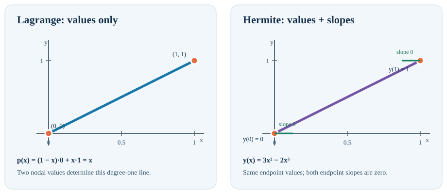

*Both plots label x and y, mark 0, 0.5, and 1 on the horizontal axis, and mark 1 on the vertical axis. The shared origin is labeled once to keep it clear. The Lagrange example is the line through the two values; the Hermite example also matches zero slope at both endpoints, making a cubic that starts and finishes flat.*

In the left plot, $x$ is the position where we want to find the curve's height. The subscripts in $x_0$ and $x_1$ are just labels: $x_0=0$ is the first input position, and $x_1=1$ is the second. They are not multiplication. The corresponding heights are $y_0=0$ and $y_1=1$, so the two plotted data points are $(x_0,y_0)=(0,0)$ and $(x_1,y_1)=(1,1)$.

For these endpoints, the two Lagrange functions are $L_0(x)=1-x$ and $L_1(x)=x$. They tell how much each endpoint height contributes at the chosen position $x$: at the left endpoint $x=0$, their values are 1 and 0; at the right endpoint $x=1$, their values are 0 and 1.

The interpolation rule multiplies each endpoint height by its function value, then adds the two contributions:

$$
p(x)=y_0L_0(x)+y_1L_1(x)=0(1-x)+1x=x.
$$

Here is each substitution: the general rule is $p(x)=y_0L_0(x)+y_1L_1(x)$. In this example, the left height is $y_0=0$ and its function is $L_0(x)=1-x$; the right height is $y_1=1$ and its function is $L_1(x)=x$. Replacing those four pieces gives $p(x)=0(1-x)+1x$. The first product is zero, and $1x=x$, so the result is $p(x)=x$.

For a numerical example, choose $x=0.25$. This means we are one quarter of the way from the left endpoint $x_0=0$ to the right endpoint $x_1=1$:

$$
\begin{aligned}
L_0(0.25) &= 1-0.25 = 0.75,\\
L_1(0.25) &= 0.25,\\
p(0.25) &= y_0L_0(0.25)+y_1L_1(0.25)\\
         &= 0(0.75)+1(0.25)\\
         &= 0+0.25\\
         &= 0.25.
\end{aligned}
$$

So at the input position $x=0.25$, the interpolated height is $0.25$. The $0.75$ and $0.25$ are the function values at that position; each is multiplied by its endpoint height before the two contributions are added.

This particular Lagrange interpolant is linear because it uses two distinct nodes. **Not all Lagrange polynomials are linear:** with three distinct nodes, the Lagrange interpolant can be quadratic; with $n+1$ nodes, its degree is at most $n$ (and can be lower for special data).

In the right plot, $x$ is the horizontal input and $y(x)$ is the vertical height of the curve. The left endpoint is at input $x=0$ and height $y(0)=0$; the right endpoint is at $x=1$ and height $y(1)=1$. The labels are shown beside those points. A prime means slope, so $y'(0)=0$ and $y'(1)=0$ say the curve is flat at both endpoints. One cubic curve with those four conditions is

$$
y(x)=3x^2-2x^3,\qquad y(0)=0,\quad y(1)=1,\quad y'(0)=y'(1)=0.
$$

For two points, a line has two coefficients, so two values determine it. A cubic has four coefficients, so it can satisfy four conditions: the value and slope at each endpoint. The extra data let us control how the curve arrives at the points. For example, changing the left slope tilts the curve as it leaves the left dot.

The two-point picture introduces values and slopes. Now use three reference support points, $s_1=-1$, $s_2=0$, and $s_3=1$. First we derive the middle point's slope basis, then compare a value basis with a slope basis, and finally combine all six functions in a fully worked summation.

<section class="hs-calculation-box" markdown="1" aria-label="How the middle-node slope basis is constructed">

## Where the slope-basis polynomial comes from

Use the declared reference support points $s_1=-1$, $s_2=0$, and $s_3=1$. In $H_{2,1}(s)$, $H$ names a Hermite basis polynomial, the first subscript 2 selects the middle support point, the second subscript 1 selects slope data, and $s$ is the input coordinate.

The slope basis is a polynomial we construct to satisfy the slope conditions; it is **not** the derivative of the value-basis polynomial. For the middle node, call it $q(s)=H_{2,1}(s)$. Its job is to have zero value at all three nodes, zero slope at the two outside nodes, and unit slope at the middle node:

$$
q(-1)=q(0)=q(1)=0,
\qquad
q'(-1)=0,\quad q'(0)=1,\quad q'(1)=0.
$$

Here is how those conditions determine the polynomial. Since both $q$ and its slope are zero at $s=-1$ and $s=1$, those are double roots. The required value $q(0)=0$ adds a root at the middle. A degree-five polynomial with those roots must have this form, for some scale factor $C$:

$$
q(s)=C(s+1)^2s(s-1)^2=C s(1-s^2)^2.
$$

Near $s=0$, this polynomial begins as $q(s)=Cs+\text{higher powers of }s$, so its slope there is $q^{\prime}(0)=C$. The required unit slope makes $C=1$. Expanding gives the actual polynomial plotted on the right:

$$
\boxed{H_{2,1}(s)=s(1-s^2)^2=s-2s^3+s^5}.
$$

Differentiate it to check the three nodal slopes:

$$
H'_{2,1}(s)=1-6s^2+5s^4,
\qquad
\bigl(H'_{2,1}(-1),H'_{2,1}(0),H'_{2,1}(1)\bigr)=(0,1,0).
$$

So the graph has to cross zero at all three nodes, but leave the middle node with positive slope. That is why it dips below zero to the left and rises above zero to the right. In an interpolant, a supplied middle slope $m_2$ multiplies this function: $m_2H_{2,1}(s)$ contributes zero value at every node, but contributes exactly slope $m_2$ at $s_2=0$.

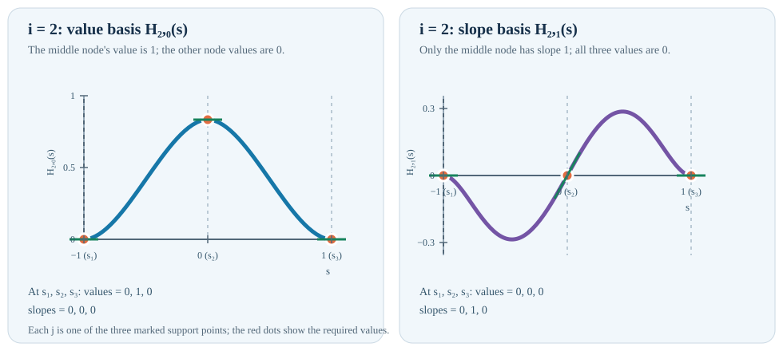

*The blue curve is the middle value basis $H_{2,0}$; the purple curve is the middle slope basis $H_{2,1}$. Both have zero value at the outside support points. The value basis has unit height and zero slope at the middle point; the slope basis has zero height and unit slope there.*

</section>

<section class="hs-calculation-box" markdown="1" aria-label="Why each support point has a value and slope basis">

## Two one-dimensional basis functions per support coordinate

***At each support point $s_i$, we are given two scalar data: the field value $u(s_i)$ and the slope $u'(s_i)$. Both basis functions are scalar-valued polynomials: $H_{i,0}$ multiplies the value, while $H_{i,1}$ multiplies the slope.*** The slope basis is its own polynomial; it is not the derivative of the value basis.

Here, a *support point* means one node in the **one-dimensional interpolation rule**, at coordinate $s_i$. It does not mean a point belonging to a function. In the 3D hexahedron, a geometric support node is a coordinate triple $(s_i,s_j,s_k)$; the one-dimensional functions from the three coordinate directions are combined to make its 3D basis functions.

There are two one-dimensional functions for each coordinate $s_i$ because that node supplies **two independent kinds of data**: its field value $u(s_i)$ and its first derivative $u'(s_i)$. One basis function carries the value while making every other nodal value and slope zero. Its partner carries the slope while making every nodal value zero and all other nodal slopes zero. The index $i$ chooses the one-dimensional node; the final index 0 or 1 chooses whether its function carries value or slope data.

The graph below turns on one middle-node datum at a time. First set the middle value to 2 and every other nodal datum to zero. Then set the middle slope to 3 and every other nodal datum to zero. The polynomials act like separate controls: the value basis raises the curve at the node without tilting it; the slope basis tilts the curve through the node without changing its height.

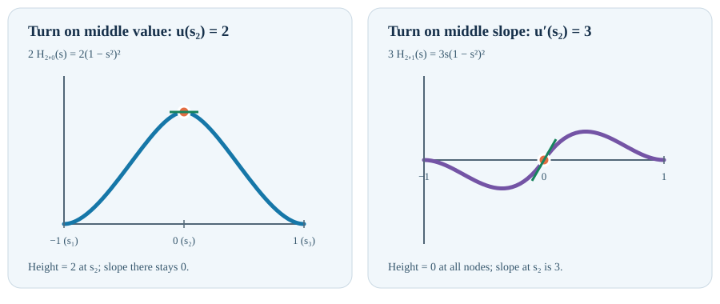

*Each curve is the contribution from just one DOF, with the other nodal data set to zero. Add the two contributions to use both pieces of information: $u(s)=u(s_2)H_{2,0}(s)+u'(s_2)H_{2,1}(s)$, plus the contributions from the other support points. The green marks show the required tangent direction at the middle node.*

For these three one-dimensional coordinates there are $3\times2=6$ functions in total. In general, $m$ one-dimensional support coordinates with value and slope data require $2m$ one-dimensional basis functions. At a 3D Hex support node, choose one of the two functions in each direction and multiply the three choices. This gives $2\times2\times2=8$ tensor-product functions at the node, paired with its value, three first derivatives, three mixed second derivatives, and one mixed third derivative. For example, the center node of `HermiteHex27` uses the center-coordinate value/slope pair in each of $\xi$, $\eta$, and $\zeta$; their eight products are the eight scalar DOF shapes at that Hex node.
For three equally spaced points (-1,0,1), there are six functions and the polynomial degree is five. For four equally spaced points (-1,-1/3,1/3,1), there are eight functions and the degree is seven.

</section>

<section class="hs-calculation-box" markdown="1" aria-label="Worked Hermite example with three support points">

## Worked example: three declared support points

For the complete worked example, use the same three points on the reference line:

$$
s_1=-1,\qquad s_2=0,\qquad s_3=1.
$$

Here $s$ is the horizontal input coordinate. A Hermite basis function $H_{i,0}(s)$ is a polynomial curve that carries a value at support point $i$: it is 1 at that point, 0 at the other two, and has zero slope at all three. The companion $H_{i,1}(s)$ carries a slope: its value is 0 at all three points, and its slope is 1 at point $i$ and 0 at the others. The first index chooses a support point; the second chooses value (0) or slope (1).

For example, the table spells out all six jobs. The ordered triples always follow the declared point order $s_1=-1$, $s_2=0$, $s_3=1$:

| Basis polynomial* | Values at $(s_1,s_2,s_3)$ | Slopes at $(s_1,s_2,s_3)$ |
|---|---|---|
| $H_{1,0}$ | $(1,0,0)$ | $(0,0,0)$ |
| $H_{1,1}$ | $(0,0,0)$ | $(1,0,0)$ |
| $H_{2,0}$ | $(0,1,0)$ | $(0,0,0)$ |
| $H_{2,1}$ | $(0,0,0)$ | $(0,1,0)$ |
| $H_{3,0}$ | $(0,0,1)$ | $(0,0,0)$ |
| $H_{3,1}$ | $(0,0,0)$ | $(0,0,1)$ |

**Notation key (*):** $H$ names a Hermite basis polynomial. In $H_{i,a}(s)$, the first subscript $i$ selects the support point; the second subscript $a$ identifies the data type: $a=0$ means value, and $a=1$ means slope. The $(s)$ says which coordinate the polynomial is evaluated at. For example, $H_{2,0}(s)$ means “the middle support point's value basis, evaluated at coordinate $s$.”

The boxed requirements above can also be read as this smaller value-only table. Each **row is a basis function**; each **column is the coordinate where we evaluate it**. This is a table of polynomial outputs, not a picture of support points arranged in a row or grid:

| Value basis (row $i$) | At $s_1=-1$ ($j=1$) | At $s_2=0$ ($j=2$) | At $s_3=1$ ($j=3$) |
|---|---:|---:|---:|
| $H_{1,0}$ | 1 | 0 | 0 |
| $H_{2,0}$ | 0 | 1 | 0 |
| $H_{3,0}$ | 0 | 0 | 1 |

For instance, the middle row says $H_{2,0}(s_1)=0$, $H_{2,0}(s_2)=1$, and $H_{2,0}(s_3)=0$. Thus, when the summation is evaluated at the middle support point $s_2$, only its matching value input $v_2$ contributes. The slope-basis curves have zero values at all three points; their matching slopes are selected by the analogous derivative conditions.

The six polynomials that meet those requirements are:

$$
\begin{aligned}
H_{1,0}(s)&=\tfrac14(3s+4)s^2(s-1)^2,&
H_{1,1}(s)&=\tfrac14(s+1)s^2(s-1)^2,\\
H_{2,0}(s)&=(1-s^2)^2,&
H_{2,1}(s)&=s(1-s^2)^2,\\
H_{3,0}(s)&=\tfrac14(4-3s)s^2(s+1)^2,&
H_{3,1}(s)&=\tfrac14(s-1)s^2(s+1)^2.
\end{aligned}
$$

Each graph below shows one of these six polynomials over the whole interval. The red dots show its value at each support point. The green short lines show its tangent slope there. For instance, if the only nonzero input data are value 1 at the middle point, the interpolated curve is $H_{2,0}(s)$. If instead the only nonzero datum is slope 1 at the middle point, the curve is $H_{2,1}(s)$.

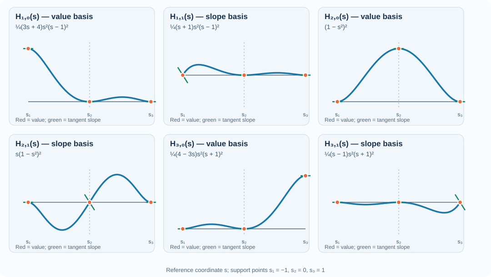

*All six basis polynomials for the explicitly declared support points $s_1=-1$, $s_2=0$, and $s_3=1$. Red dots mark values; green tangent marks show slopes.*

For arbitrary prescribed values $v_i$ and slopes $d_i$ at these three points, the interpolating polynomial is the sum of each datum times its matching basis polynomial:

$$
u(s)=\sum_{i=1}^{3}\left[v_iH_{i,0}(s)+d_iH_{i,1}(s)\right].
$$

**Symbol dictionary**

| Symbol | Meaning and use |
|---|---|
| $u(s)$ | The interpolated curve's height at the input coordinate $s$. This is the result we calculate. |
| $s$ | The input coordinate where we want the curve's height. In the example below, we evaluate at $s=0.5$. |
| $s_i$ | Support point number $i$: here $s_1=-1$, $s_2=0$, and $s_3=1$. |
| $i$ | The summation counter. It takes the values 1, 2, then 3, adding one point's value and slope contributions each time. |
| $v_i$ | The height supplied at point $s_i$. It is input data, not something calculated by the sum. |
| $d_i$ | The supplied slope at point $s_i$, measured as derivative with respect to $s$. It is also input data. |
| $H_{i,0}(s)$ | The value basis curve for point $i$. It is 1 at $s_i$, 0 at the other support points, and has zero slope at all three. |
| $H_{i,1}(s)$ | The slope basis curve for point $i$. It is 0 at all three support points; its slope is 1 at $s_i$ and 0 at the others. |

The square brackets group the two contributions from one support point: its height times the value basis, plus its slope times the slope basis. The summation adds those brackets for points 1, 2, and 3.

**Worked summation with actual data**

Choose these input heights and slopes:

| Point | Coordinate $s_i$ | Input height $v_i$ | Input slope $d_i$ |
|---|---:|---:|---:|
| 1 | $s_1=-1$ | $v_1=1$ | $d_1=1$ |
| 2 | $s_2=0$ | $v_2=2$ | $d_2=2$ |
| 3 | $s_3=1$ | $v_3=3$ | $d_3=3$ |

First replace every input height and slope in the sum with the numbers from the data table. Leave $s$ unevaluated for now:

$$
\begin{aligned}
u(s)={}&1\cdot H_{1,0}(s)+1\cdot H_{1,1}(s)\\
&+2\cdot H_{2,0}(s)+2\cdot H_{2,1}(s)\\
&+3\cdot H_{3,0}(s)+3\cdot H_{3,1}(s).
\end{aligned}
$$

Now evaluate that curve at $s=0.5$. Substituting $s=0.5$ into each basis polynomial gives:

| Basis value | Substitute $s=0.5$ | Result |
|---|---|---:|
| $H_{1,0}(0.5)$ | $\frac14(3\cdot0.5+4)(0.5)^2(0.5-1)^2$ | $\frac{11}{128}$ |
| $H_{1,1}(0.5)$ | $\frac14(0.5+1)(0.5)^2(0.5-1)^2$ | $\frac{3}{128}$ |
| $H_{2,0}(0.5)$ | $(1-0.5^2)^2$ | $\frac{72}{128}$ |
| $H_{2,1}(0.5)$ | $0.5(1-0.5^2)^2$ | $\frac{36}{128}$ |
| $H_{3,0}(0.5)$ | $\frac14(4-3\cdot0.5)(0.5)^2(0.5+1)^2$ | $\frac{45}{128}$ |
| $H_{3,1}(0.5)$ | $\frac14(0.5-1)(0.5)^2(0.5+1)^2$ | $-\frac{9}{128}$ |

Now expand the summation. Each input height or slope is multiplied by the matching basis value from the table above:

$$
\begin{aligned}
u(0.5)={}&[v_1H_{1,0}(0.5)+d_1H_{1,1}(0.5)]\\
&+[v_2H_{2,0}(0.5)+d_2H_{2,1}(0.5)]\\
&+[v_3H_{3,0}(0.5)+d_3H_{3,1}(0.5)]\\
={}&[1\cdot\tfrac{11}{128}+1\cdot\tfrac{3}{128}]\\
&+[2\cdot\tfrac{72}{128}+2\cdot\tfrac{36}{128}]\\
&+[3\cdot\tfrac{45}{128}+3\cdot(-\tfrac{9}{128})]\\
={}&\tfrac{14}{128}+\tfrac{216}{128}+\tfrac{108}{128}\\
={}&\tfrac{338}{128}=\tfrac{169}{64}=2.640625.
\end{aligned}
$$

Therefore, for this chosen set of six input data, the interpolated curve has height $2.640625$ at $s=0.5$. The example shows every substitution: $v_1,v_2,v_3$ are replaced by $1,2,3$; $d_1,d_2,d_3$ are replaced by $1,2,3$; and each $H$ is replaced by its evaluated value at $0.5$.

</section>

Now that all six functions are visible in a specific example, we can state the same requirements for any number $m$ of support points.

Label the $m$ support points $s_1,s_2,\ldots,s_m$. The subscript tells us which point we mean. Hermite interpolation builds two basis polynomials for each point: one for its value and one for its slope. The first subscript $i$ chooses which point's basis polynomials we are building. The second subscript, 0 or 1, chooses value or slope.

To define a chosen basis polynomial, we must say what it does at every support point. The index $j$ runs through the points where we check it, so $j=1,2,\ldots,m$. For example, with three points and the middle point selected ($i=2$), $j$ checks the first, middle, and last points in turn. The middle value basis $H_{2,0}$ must have values $0,1,0$ there; the middle slope basis $H_{2,1}$ must have slopes $0,1,0$ there.

Each basis polynomial has degree at most $2m-1$, so it has $2m$ coefficients. The conditions at all $m$ points determine those coefficients:

$$
H_{i,0}(s_j)=\delta_{ij},\quad H'_{i,0}(s_j)=0,\qquad
H_{i,1}(s_j)=0,\quad H'_{i,1}(s_j)=\delta_{ij}.
$$

In the equation, $i$ stays fixed while $j$ checks every support point. The subscript 0 means “value basis”; 1 means “slope basis.” The Kronecker delta is the on/off rule that gives 1 when the selected and checked point match, and 0 otherwise. For three points, the value-basis results form the 3×3 identity table in the worked-example box: row $i$ identifies the basis function, and column $j$ identifies where it is evaluated.

$$
\delta_{ij}=\begin{cases}1,&i=j,\\0,&i\ne j.\end{cases}
$$

## Confluent Vandermonde construction

<section class="hs-calculation-box" markdown="1" aria-label="Purpose of the confluent Vandermonde method">

**Purpose, in plain terms:** Given $m$ distinct support coordinates and a value plus a slope at each one, this method calculates the coefficients of the unique polynomial of degree at most $2m-1$ that matches all $2m$ numbers. The input is the support locations and the prescribed values/slopes; the output is the polynomial coefficients.

**How we use the result later:** First, set one prescribed datum to 1 and all the others to 0. Solving once for each such pattern produces the value and slope basis polynomials $H_{i,0}$ and $H_{i,1}$. Then multiply those basis polynomials by the actual values and slopes and add them, as in the worked summation above. In three dimensions, the one-dimensional bases are combined by tensor products to form the Hex element shape functions.

The method is called *confluent Vandermonde* because, at every support coordinate, it uses two rows at that same location: one row for the polynomial value and one for its slope.

</section>

Write the polynomial using its coefficient vector:

$$
p(s)=\sum_{k=0}^{2m-1}c_k s^k,
\qquad
\mathbf{c}=\begin{bmatrix}c_0&c_1&\cdots&c_{2m-1}\end{bmatrix}^{\mathsf T}.
$$

At support point $s_i$, evaluating the polynomial produces a row of powers. Differentiating it first produces the slope row:

$$
\begin{aligned}
\text{value row at }s_i &: \begin{bmatrix}1&s_i&s_i^2&\cdots&s_i^{2m-1}\end{bmatrix},\\
\text{slope row at }s_i &: \begin{bmatrix}0&1&2s_i&\cdots&(2m-1)s_i^{2m-2}\end{bmatrix}.
\end{aligned}
$$

Stack one value row and one slope row for every support point. The resulting confluent Vandermonde system connects the polynomial coefficients to all the nodal data:

$$
\underbrace{\begin{bmatrix}
1&s_1&s_1^2&\cdots&s_1^{2m-1}\\
0&1&2s_1&\cdots&(2m-1)s_1^{2m-2}\\
\vdots&\vdots&\vdots&\ddots&\vdots\\
1&s_m&s_m^2&\cdots&s_m^{2m-1}\\
0&1&2s_m&\cdots&(2m-1)s_m^{2m-2}
\end{bmatrix}}_{\mathbf{A}\;\text{(confluent Vandermonde)}}
\underbrace{\begin{bmatrix}c_0\\c_1\\\vdots\\c_{2m-1}\end{bmatrix}}_{\mathbf{c}\;\text{(polynomial coefficients)}}
=
\underbrace{\begin{bmatrix}p(s_1)\\p'(s_1)\\\vdots\\p(s_m)\\p'(s_m)\end{bmatrix}}_{\mathbf{d}\;\text{(values and slopes)}}.
$$

In short, $\mathbf{A}\mathbf{c}=\mathbf{d}$, so solving for the coefficients gives $\mathbf{c}=\mathbf{A}^{-1}\mathbf{d}$. The inverse turns the requested values and slopes into the polynomial that matches them.

The companion implementation constructs this matrix in core/hermite_tensor/basis.py and evaluates its basis and derivatives. It is maintained separately from the Lagrange cardinal-product construction.

## Why these are Hermite functions

At each support point, one function returns unit value and zero slope while its paired function returns zero value and unit slope. The interpolant therefore reproduces each supplied value and slope exactly. Three or four points per direction create the support grids for HermiteHex27 and HermiteHex64; each point has both kinds of one-dimensional data.

## From these polynomials to Hermite element types

An element is built by turning interpolation rules into **shape functions**. A shape function is a basis polynomial tied to one local degree of freedom (DOF): it is one for that DOF and zero for the other nodal data. Then the element interpolant is the sum of each DOF multiplied by its shape function. Lagrange elements attach values to nodes. Hermite elements attach values **and derivatives** to nodes, so their basis must satisfy both kinds of conditions.

For a two-node, one-dimensional cubic Hermite element with physical length $L=x_2-x_1$, use the reference coordinate $\xi=(x-x_1)/L$. The four DOFs are the endpoint values $u_1,u_2$ and physical slopes $\theta_1=\left.\frac{du}{dx}\right\vert_{x=x_1}$, $\theta_2=\left.\frac{du}{dx}\right\vert_{x=x_2}$. Its interpolation is

$$
u(\xi)=N_1(\xi)u_1+N_2(\xi)\theta_1+N_3(\xi)u_2+N_4(\xi)\theta_2,
$$

$$
\begin{aligned}
N_1(\xi)&=1-3\xi^2+2\xi^3, & N_2(\xi)&=L(\xi-2\xi^2+\xi^3),\\
N_3(\xi)&=3\xi^2-2\xi^3, & N_4(\xi)&=L(-\xi^2+\xi^3).
\end{aligned}
$$

$N_1,N_3$ carry endpoint values; $N_2,N_4$ carry endpoint slopes. The factors of $L$ convert a physical slope into a reference-coordinate polynomial coefficient. Evaluating $u$ at either endpoint returns that endpoint's value, and differentiating with respect to the physical coordinate $x$ returns the specified endpoint slopes. The plotted $h(x)=3x^2-2x^3$ is exactly the value basis $N_3$ on a unit-length interval; it is the cubic that raises the right endpoint value while keeping both endpoint slopes zero.

The same construction extends to the 3D element types in this tutorial. First choose one-dimensional Hermite basis functions for the support points in each coordinate. Tensor products combine them across $x,y,z$; at each support point the eight combinations represent the value, three first derivatives, three mixed second derivatives, and one mixed third derivative. Those combinations are the local DOFs used by `HermiteHex27` (a $3\times3\times3$ support grid) and `HermiteHex64` (a $4\times4\times4$ support grid). Thus the endpoint picture explains the rule used to build every basis function: prescribe which nodal value or derivative it carries, enforce zeros for the others, and combine the resulting one-dimensional functions into the element basis.

---

<a id="hermite-02"></a>
# Hermite 02 - Build the 3D tensor basis

`HermiteHex27` is a cube-shaped reference element with three support points on each axis: $-1,0,1$. The picture shows the 27 support points; the center point is highlighted. At every point, the element stores a field value and derivative data, not just a value.

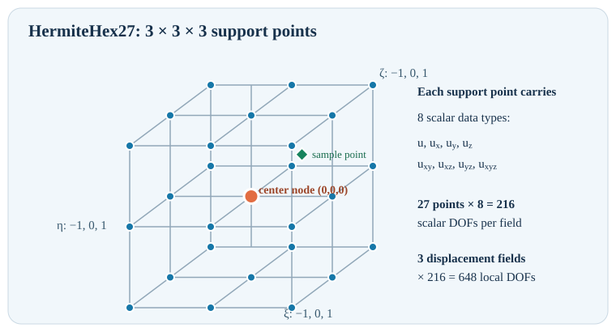

*The blue dots are the 27 interpolation support points. The highlighted center node is $(\xi,\eta,\zeta)=(0,0,0)$; the green diamond is an interior point where we can evaluate the interpolated field. Each point carries the eight derivative combinations shown.*

## A real tensor-product calculation

At the three one-dimensional support points $-1,0,1$, the middle node's value basis and slope basis are

$$
H_{1,0}(s)=(1-s^2)^2=1-2s^2+s^4,\qquad
H_{1,1}(s)=s(1-s^2)^2=s-2s^3+s^5.
$$

They are chosen so that at the middle node, $H_{1,0}(0)=1$, $H_{1,0}'(0)=0$, $H_{1,1}(0)=0$, and $H_{1,1}'(0)=1$; at the other two nodes, both value and slope data for these middle-node functions are zero. The other two support points have their own paired polynomials, giving six 1D functions per axis and $6^3=216$ scalar tensor-product functions in a Hex27.

For completeness, the six one-dimensional polynomials used on the three-point axis are:

$$
\begin{array}{c|cc}
\text{support point} & \text{value basis }H_{i,0}(s) & \text{slope basis }H_{i,1}(s)\\ \hline
-1\ (i=0) & \frac14s^2(s-1)^2(3s+4) & -\frac1{12}s^2(s-1)^2\\[2pt]
0\ (i=1) & (1-s^2)^2 & s(1-s^2)^2\\[2pt]
1\ (i=2) & \frac14s^2(s+1)^2(4-3s) & \frac1{12}s^2(s+1)^2
\end{array}
$$

The subscript $0$ means “unit value at this support point”; subscript $1$ means “unit derivative there.” Every other value and derivative at all three support points is zero. Each 3D scalar shape is made by choosing one of these six polynomials independently for $\xi$, $\eta$, and $\zeta$, then multiplying the three choices (with length factors for derivative DOFs).

Choose the center support node $(i,j,k)=(1,1,1)$ and its mixed $xz$ derivative DOF, whose derivative mask is $(a,b,c)=(1,0,1)$. On a physical cube with side lengths $h_x=h_y=h_z=2$, the half-length scales are all one. Its actual 3D shape function is therefore

$$
N_{111}^{101}(\xi,\eta,\zeta)
=\left[\frac{h_x}{2}H_{1,1}(\xi)\right]
 H_{1,0}(\eta)
 \left[\frac{h_z}{2}H_{1,1}(\zeta)\right]
=H_{1,1}(\xi)H_{1,0}(\eta)H_{1,1}(\zeta).
$$

Now evaluate at the green point $(\xi,\eta,\zeta)=(0.5,-0.5,0.25)$. Substitute one coordinate at a time:

$$
\begin{aligned}
H_{1,1}(0.5)&=0.5(1-0.5^2)^2=0.5(0.75)^2=0.28125=\frac{9}{32},\\
H_{1,0}(-0.5)&=(1-(-0.5)^2)^2=(0.75)^2=0.5625=\frac{9}{16},\\
H_{1,1}(0.25)&=0.25(1-0.25^2)^2=0.25(0.9375)^2=0.2197265625=\frac{225}{1024}.
\end{aligned}
$$

Multiply those three numbers to get the scalar basis value:

$$
N_{111}^{101}(0.5,-0.5,0.25)
=\frac{9}{32}\times\frac{9}{16}\times\frac{225}{1024}
=\frac{18225}{524288}
\approx 0.0347614.
$$

That number is the weight of the center node's $u_{xz}$ DOF in the interpolated scalar field at this point. For example, if that one DOF were 4 and every other DOF were zero, its contribution to the field here would be $4\times0.0347614\approx0.139046$. In a real element, we add the corresponding contribution from every one of the 216 scalar DOFs (or 648 displacement DOFs).

The implementation in `core/elements/hermite/tensor_product/basis.py` computes these same weights: `one_dimensional_hermite` evaluates the 1D polynomials and `tensor_hermite_shapes` multiplies the three directional factors. `HermiteHex27.displacement_at` uses the resulting weights to interpolate displacement; the strain and stiffness calculations use their physical gradients.

## What the nodal functional does

The nodal functional is the operation that **reads one particular piece of nodal data from a function**. For support point $(i,j,k)$ and derivative type $(a,b,c)$, write it as

$$
\ell_{ijk}^{abc}[u]
=\left.
\frac{\partial^{a+b+c}u}
{\partial x^a\,\partial y^b\,\partial z^c}
\right|_{\text{support node }(i,j,k)},
\qquad a,b,c\in\{0,1\}.
$$

If an exponent is zero, there is no derivative in that direction: $(0,0,0)$ reads the value $u$, $(1,0,0)$ reads $u_x$, and $(1,0,1)$ reads the mixed derivative $u_{xz}$. So a nodal functional is like a precisely defined measurement at a node. It is not another basis polynomial, and it is not an extra input to choose during evaluation. In this implementation it acts on the interpolated field; the matching DOF stores the value that this measurement must return.

Each basis function is built to be *dual* to one such measurement:

$$
\ell_{i'j'k'}^{a'b'c'}\!\left[N_{ijk}^{abc}\right]
=\delta_{ii'}\delta_{jj'}\delta_{kk'}\delta_{aa'}\delta_{bb'}\delta_{cc'}.
$$

The deltas mean “one for the matching node and derivative type, zero for every other one.” We can calculate the matching functional directly for our selected shape. At the center node, $\xi=\eta=\zeta=0$, and the affine map gives $\partial\xi/\partial x=2/h_x$ and $\partial\zeta/\partial z=2/h_z$:

$$
\begin{aligned}
\ell_{111}^{101}[N_{111}^{101}]
&=\left.\frac{\partial^2 N_{111}^{101}}{\partial x\,\partial z}\right|_{(0,0,0)}\\
&=\frac{h_x}{2}\frac{h_z}{2}\frac{2}{h_x}\frac{2}{h_z}\,
 H'_{1,1}(0)H_{1,0}(0)H'_{1,1}(0)\\
&=1\times1\times1\times1\times1=1.
\end{aligned}
$$

The half-length factors in the shape cancel the coordinate-conversion factors from differentiating, leaving exactly one. Evaluating any other nodal functional on this shape returns zero. This is how the interpolant preserves the data that were put into its DOF vector.

For one scalar field, the full interpolation is the sum of all data times their matching shape functions:

$$
u_h(\xi,\eta,\zeta)
=\sum_{i,j,k=0}^{2}\ \sum_{a,b,c\in\{0,1\}}
\ell_{ijk}^{abc}[u]\,N_{ijk}^{abc}(\xi,\eta,\zeta).
$$

In a finite-element solve, the solver's unknowns provide those nodal data. At integration points, the element evaluates the shape functions and their gradients to compute displacement and strain from those unknowns. The nodal functionals define what each unknown means and guarantee that the basis interpolates it correctly. For nonconforming mesh interfaces, the code also evaluates these same value/derivative measurements from a neighboring element to construct hanging-node constraints in `tensor_hermite_functional_shapes`.

One coordinate detail is important: the polynomials are evaluated in parent coordinates $(\xi,\eta,\zeta)$, while this element stores physical-coordinate derivatives ($u_x,u_y,u_z,\ldots$). For an affine box, the shape factors for a derivative in direction $x$, $y$, or $z$ include $h_x/2$, $h_y/2$, or $h_z/2$, respectively. These factors make the parent-coordinate polynomial reproduce the physical derivative DOF; [Lesson 03 explains this scaling](#hermite-03).

## Hex27 and Hex64 data counts

For a three-component displacement field, every support point carries three copies of the eight scalar data types. The element counts are:

| Element | Support grid | Data per point | Local displacement DOFs |
| --- | ---: | ---: | ---: |
| HermiteHex27 | 3 × 3 × 3 | 3 × 8 = 24 | 648 |
| HermiteHex64 | 4 × 4 × 4 | 3 × 8 = 24 | 1,536 |

These counts include derivative data. They are not the $3\times27$ or $3\times64$ counts of displacement-only Lagrange elements.

## Tensor ordering

The implementation enumerates support points as $(i,j,k)$ with $k$ fastest, then enumerates the eight derivative masks $(a,b,c)$, also with $c$ fastest. The vector DOF block at a point is grouped by displacement component, with its eight derivative types contiguous. A solver must use this convention consistently in interpolation, $B$, connectivity, and boundary conditions.

This is a full tensor-product Hermite space. It does not infer mixed derivatives from neighboring values: the seven derivative types are independent DOFs.

---

<a id="hermite-03"></a>
# Hermite 03 - Scale parent derivatives

## One physical element, two coordinate systems

The Hermite polynomials are easiest to define on a standard reference cube, where each coordinate runs from $-1$ to $1$. The finite-element model, however, lives on a physical box measured in length units. The map between them changes the numerical size of derivatives. This lesson works through that conversion for one specific element.

Use a box whose lower corner is $(0,0,0)$ and whose side lengths are $h_x=4$, $h_y=6$, and $h_z=8$. Its reference cube and physical box are shown below. The green point has reference coordinates $(\xi,\eta,\zeta)=(0.5,0,-0.5)$.

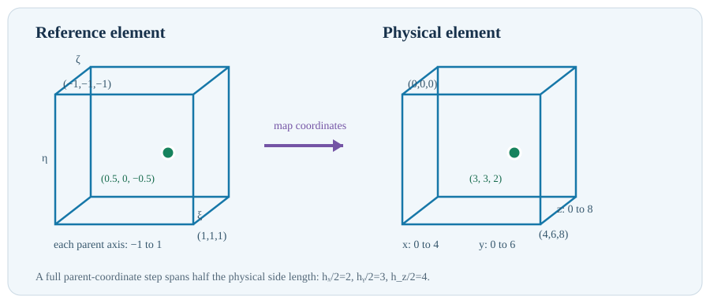

*The reference cube gives every element the same convenient coordinates. The physical box supplies its actual location and size. Since the physical box is twice as long as the parent interval in each direction, one unit of parent-coordinate change corresponds to half a physical side length.*

## 1. Map a point before differentiating

For this box, $x_0=y_0=z_0=0$, so the coordinate map is

$$
x=2(1+\xi),\qquad y=3(1+\eta),\qquad z=4(1+\zeta).
$$

Substitute the green point one coordinate at a time:

$$
\begin{aligned}
x&=2(1+0.5)=3,\\
y&=3(1+0)=3,\\
z&=4(1-0.5)=2.
\end{aligned}
$$

So evaluating a field at parent point $(0.5,0,-0.5)$ means evaluating the same field at physical point $(3,3,2)$. Coordinates tell us *where* we are; the derivative scales below tell us how a change in one coordinate compares to a change in the other.

## 2. Convert one derivative at a time

Differentiate the map. For example, $dx/d\xi=2$, so the chain rule says

$$
\frac{\partial u}{\partial\xi}
=\frac{\partial u}{\partial x}\frac{dx}{d\xi}
=2\frac{\partial u}{\partial x}.
$$

Rearrange to get the physical derivative from the parent derivative:

$$
u_x=\frac{\partial u}{\partial x}
=\frac{1}{2}\frac{\partial u}{\partial\xi}
=\frac{2}{h_x}u_\xi.
$$

In the same way, for this box,

$$
u_y=\frac{1}{3}u_\eta,\qquad
u_z=\frac{1}{4}u_\zeta.
$$

The fractions are reciprocals of the half-lengths. A given physical change in $x$ is only half as large in parent coordinates when the element is wide; converting a parent slope back to a physical slope therefore multiplies by $2/h_x$.

### Numerical check with a real function

Let $u(x,y,z)=6xz$. At the mapped point $(x,y,z)=(3,3,2)$, its value and physical derivatives are

$$
u=6(3)(2)=36,\qquad
u_x=6z=12,\qquad
u_y=0,\qquad
u_z=6x=18.
$$

Now express the same function in parent coordinates. Since $x=2(1+\xi)$ and $z=4(1+\zeta)$,

$$
u(\xi,\eta,\zeta)=6\,[2(1+\xi)]\,[4(1+\zeta)]
=48(1+\xi)(1+\zeta).
$$

Differentiate with respect to the parent coordinates and substitute $(0.5,0,-0.5)$:

$$
u_\xi=48(1+\zeta)=48(0.5)=24,\qquad
u_\eta=0,\qquad
u_\zeta=48(1+\xi)=48(1.5)=72.
$$

Convert those results back to physical slopes:

$$
u_x=\frac12(24)=12,\qquad
u_y=\frac13(0)=0,\qquad
u_z=\frac14(72)=18.
$$

We recover the same physical derivatives. This is what the first-derivative scale factors do in practice.

## 3. Convert mixed derivatives by applying both scales

The mask $(a,b,c)$ says whether to differentiate once in each direction: 0 means no derivative there, 1 means take one. For $(a,b,c)=(1,0,1)$, the physical quantity is $u_{xz}$. Apply the chain rule in $x$ and then in $z$:

$$
u_{\xi\zeta}
=\frac{h_x}{2}\frac{h_z}{2}u_{xz}
=2\cdot4\cdot u_{xz}
=8u_{xz}.
$$

For our function, $u_{xz}=6$. Therefore

$$
u_{\xi\zeta}=8(6)=48,
\qquad\text{and conversely}\qquad
u_{xz}=\frac{1}{8}(48)=6.
$$

The same rule applies to any mask $(a,b,c)$ with entries 0 or 1:

$$
\frac{\partial^{a+b+c}u}{\partial\xi^a\partial\eta^b\partial\zeta^c}
=\left(\frac{h_x}{2}\right)^a
 \left(\frac{h_y}{2}\right)^b
 \left(\frac{h_z}{2}\right)^c
\frac{\partial^{a+b+c}u}{\partial x^a\partial y^b\partial z^c}.
$$

For this $4\times6\times8$ box, the eight cases are:

| Mask $(a,b,c)$ | What it measures | Parent derivative in terms of physical data |
|---|---|---|
| $(0,0,0)$ | $u$ | $u$ |
| $(1,0,0)$ | $u_x$ | $u_\xi=2u_x$ |
| $(0,1,0)$ | $u_y$ | $u_\eta=3u_y$ |
| $(0,0,1)$ | $u_z$ | $u_\zeta=4u_z$ |
| $(1,1,0)$ | $u_{xy}$ | $u_{\xi\eta}=6u_{xy}$ |
| $(1,0,1)$ | $u_{xz}$ | $u_{\xi\zeta}=8u_{xz}$ |
| $(0,1,1)$ | $u_{yz}$ | $u_{\eta\zeta}=12u_{yz}$ |
| $(1,1,1)$ | $u_{xyz}$ | $u_{\xi\eta\zeta}=24u_{xyz}$ |

The value case has no scale factor because it does not differentiate. A mixed derivative gets one half-length factor for every direction in which its mask is 1.

## 4. Why the Hermite shape functions get half-length factors

The global nodal data in this implementation are physical derivatives such as $u_x$ and $u_{xz}$. But the one-dimensional Hermite polynomials are defined using parent-coordinate derivatives such as $u_\xi$. To make a basis function match the *physical* DOF, its value-basis factor is multiplied by $h_d/2$ for each derivative in direction $d$.

For example, let $G(\xi)$ be the one-dimensional slope basis at a node, normalized so that its parent derivative there is $G'(\xi_i)=1$. If a node stores physical slope $u_x=5$, its contribution along $x$ is

$$
S(\xi)u_x=\left(\frac{h_x}{2}G(\xi)\right)5
=\left(2G(\xi)\right)5.
$$

Differentiate this contribution with respect to physical $x$. Because $\partial/\partial x=(2/h_x)\partial/\partial\xi=\frac12\partial/\partial\xi$,

$$
\left.\frac{\partial}{\partial x}\left[2G(\xi)5\right]\right|_{\xi_i}
=\frac12\,2\,G'(\xi_i)\,5
=\frac12\,2\,1\,5=5.
$$

The scale factor $h_x/2=2$ in the shape and the derivative conversion factor $2/h_x=1/2$ cancel. The basis therefore reproduces the physical slope that the global DOF represents.

The same cancellation works for the mixed $xz$ DOF. Its shape contains $(h_x/2)(h_z/2)=2\cdot4=8$. Taking one physical derivative in both directions contributes $(2/h_x)(2/h_z)=(1/2)(1/4)=1/8$. Their product is $8\cdot1/8=1$, so the shape returns exactly its stored $u_{xz}$ at its node.

## 5. Why neighboring elements must use physical derivatives

Imagine two elements sharing a face. One has $h_x=4$, and the other has $h_x=2$. The same shared physical slope, say $u_x=5$, must describe the same field on both sides. The parent-coordinate slopes differ because the elements have different sizes:

$$
u_\xi^{(left)}=\frac{4}{2}(5)=10,\qquad
u_\xi^{(right)}=\frac{2}{2}(5)=5.
$$

Those are different parent-coordinate numbers, but converting each back gives the same physical slope:

$$
u_x^{(left)}=\frac{2}{4}(10)=5,\qquad
u_x^{(right)}=\frac{2}{2}(5)=5.
$$

So the mesh stores and shares the physical derivative $u_x=5$ at the common node. Each element's shape function supplies its own half-length scale when it interpolates that shared value. If one side stored a parent slope while the other stored a physical slope, they would be assigning different meanings to the same shared DOF, and the two interpolated pieces would not match consistently.

## Where the code applies this

In `core/elements/hermite/tensor_product/basis.py`, `tensor_hermite_shapes` multiplies each 1D derivative basis by $(h_d/2)$ when that DOF differentiates along direction $d$. When the code asks for a physical gradient, it differentiates the 1D basis and multiplies by $2/h_d$. The two factors cancel in the matching nodal derivative, as in the arithmetic above. `tensor_hermite_functional_shapes` uses the same conversion when it evaluates physical nodal data to form hanging-node constraints.

This lesson uses an axis-aligned affine box, which is the geometry supported by this implementation. For a skewed or curved element, physical derivatives mix directions and require the full Jacobian chain rule (including additional terms for mixed derivatives); the simple independent factors $2/h_x$, $2/h_y$, and $2/h_z$ would no longer be sufficient.

---

<a id="hermite-04"></a>
# Hermite 04 - Form displacement and strain

Collect all scalar basis functions into N_H. For displacement components u,v,w, the displacement interpolant is assembled by placing the scalar basis in the columns belonging to its component and derivative type:

$$
\begin{bmatrix}u\\v\\w\end{bmatrix}=\mathbf N_H\mathbf d_e.
$$

Here d_e is the full local vector of value and derivative DOFs described in [Lesson 02](#hermite-02).

Differentiate each basis function in physical coordinates to obtain the strain-displacement matrix. With engineering shear strain and Voigt order (xx,yy,zz,xy,yz,xz), the six rows are

$$
\epsilon_{xx}=u_{,x},\quad \epsilon_{yy}=v_{,y},\quad \epsilon_{zz}=w_{,z},
$$


$$
\gamma_{xy}=u_{,y}+v_{,x},\quad
\gamma_{yz}=v_{,z}+w_{,y},\quad
\gamma_{xz}=u_{,z}+w_{,x}.
$$

Thus epsilon=B_H d_e. The basis is Hermite; the small-strain constitutive relation retains its familiar form sigma=D epsilon.

The local B matrix has six rows and 648 columns for HermiteHex27, or six rows and 1,536 columns for HermiteHex64. Its width follows from the derivative-valued DOFs, not from a change in the number of strain components.

---

<a id="hermite-05"></a>
# Hermite 05 - Integrate the element

Once B_H is available, linear elastic stiffness has the standard expression

$$
\mathbf K_e=\int_{\Omega_e}\mathbf B_H^T\mathbf D\mathbf B_H\,dV.
$$

A body force b uses the displacement interpolation,

$$
\mathbf f_e^{(b)}=\int_{\Omega_e}\mathbf N_H^T\mathbf b\,dV,
$$

and a face traction t uses its trace,

$$
\mathbf f_e^{(t)}=\int_{\Gamma_e}\mathbf N_H^T\mathbf t\,dA.
$$

Because N_H includes derivative DOFs, consistent loads can contribute to those generalized entries too. Loads should be integrated; a midpoint stress or force replacement is not an integration rule.

For the current degree-five and degree-seven tensor bases, the implementation selects six and eight Gauss points per axis for full integration. Curved geometry, spatially varying materials, and nonconstant tractions need additional treatment.

---

<a id="hermite-06"></a>
# Hermite 06 - Share DOFs and use the code

The structured mesh shares support points across adjacent macro-elements. At every shared point, it shares all 24 displacement and derivative DOFs. In this tensor-product construction, the face displacement trace and first derivative normal to that face are determined by the shared face data. This gives matching displacement and first-derivative traces for axis-aligned affine neighbors.

A fully fixed face must prescribe displacement values and the derivative data needed by the chosen support model. The implementation convenience boundary_dofs(face) selects every DOF at every support point on that face; the physical meaning of any less restrictive condition needs to be stated explicitly.

## Implementation map

| Responsibility | Module |
| --- | --- |
| Confluent Vandermonde and tensor Hermite functions | core/hermite_tensor/basis.py |
| HermiteHex27/64 mechanics and element loads | core/hermite_tensor/elements.py |
| Structured support-point connectivity | core/hermite_tensor/mesh.py |
| Global sparse assembly and prescribed-DOF solve | core/hermite_tensor/assembly.py |

The public classes are HermiteHex27 and HermiteHex64, available from core.hermite_tensor. Their support-point counts are 27 and 64. Their derivative DOFs are independent unknowns; no Lagrange displacement-only basis is used in these classes.

## Verification still required

Before trusting a solve, check the one-dimensional Hermite cardinal identities, tensor-product nodal functionals, physical derivative scaling, rigid-body modes, affine displacement/strain reproduction, stiffness symmetry, load resultants, and mesh refinement. Hex64 also needs memory and runtime profiling. These checks are not claimed by this tutorial.

Continue to the [Lagrange tutorial](#lagrange-overview) for the separate C0 displacement-only basis.

---

<a id="lagrange-overview"></a>
# Lagrange Tutorial001

This tutorial deliberately takes the long route. Starting with four points on a line, we build every Lagrange polynomial, plot every derivative, walk through three nested loops, and watch 64 shape functions turn into 192 physical derivatives and finally the small-strain **6 × 192** matrix. The Python companion workspace calculates the illustrations and executes the checks.

> **Terminology:** These are conventional **C0 displacement-only Lagrange** tensor-product elements, not cubic Hermite basis elements. The larger HermiteStructural project studies more than one interpolation family. Here the focus is the nodal Lagrange Hex8/Hex27/Hex64 construction.

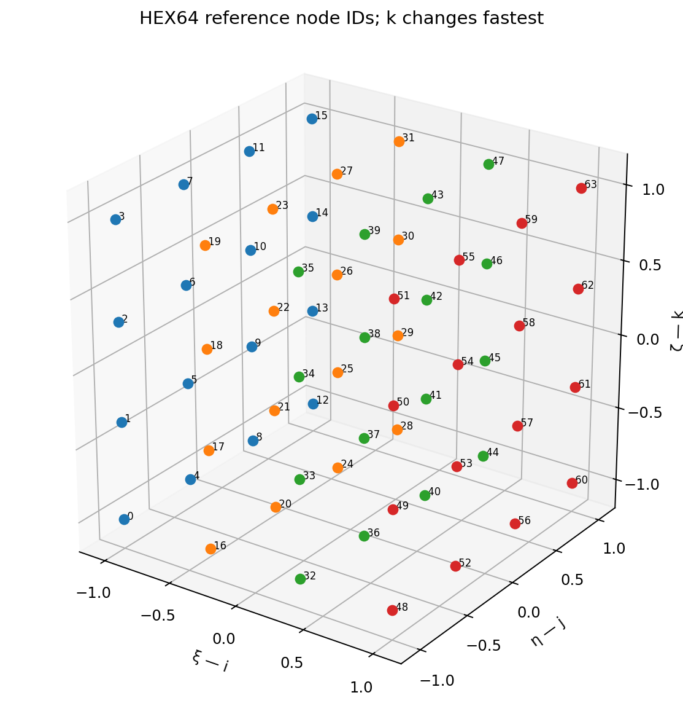

*Figure: Hex64 local node positions: 4 × 4 × 4 points, with k as the fastest-changing index. Generated by the bundled Python plotting code; see outputs/figure_manifest.json for numerical checks.*


## Explore the eight lessons

<div class="hs-lesson-grid">
<div class="hs-lesson-card"><a href="#lagrange-01">01 — Four reference points</a><p>Reference points and why the polynomial order selects a 3D node count</p></div>
<div class="hs-lesson-card"><a href="#lagrange-02">02 — The capital Π functions</a><p>From roots and products to nodal interpolation</p></div>
<div class="hs-lesson-card"><a href="#lagrange-03">03 — Differentiate the Π products</a><p>The correct product rule, including evaluations at nodes</p></div>
<div class="hs-lesson-card"><a href="#lagrange-04">04 — The nested for loops</a><p>Node indexing and visualized local numbering</p></div>
<div class="hs-lesson-card"><a href="#lagrange-05">05 — Tensor-product shape functions</a><p>Building all 64 shape values and all 192 reference derivatives</p></div>
<div class="hs-lesson-card"><a href="#lagrange-06">06 — The Jacobian</a><p>Parent coordinate gradients become physical spatial gradients</p></div>
<div class="hs-lesson-card"><a href="#lagrange-07">07 — B matrix</a><p>Six engineering strain components and 192 displacement columns</p></div>
<div class="hs-lesson-card"><a href="#lagrange-08">08 — Verification</a><p>Automated proofs and plotted numerical invariants</p></div>
</div>

## Appendix A1 — The first-degree hexahedron

[Appendix A1 — The first-degree eight-node hexahedron](#appendix-a1) preserves the HexahedronMomentDocs reference image, reproducible PyVista diagram, corner numbering, and source-code download. It connects the linear 1D L values to the trilinear Hex8 shape functions and explains the displacement and rotation annotations in the original diagram.

## What is generated, rather than merely asserted?

The included Python workspace makes **27 unique scientific figures** (PNG and SVG): reference-point diagrams for each element family; polynomial curves and derivative curves; three numbered reference cubes; nodal identity verification; partition-of-unity and derivative cancellation; an explicit node loop schematic; tensor-product composition; a bar for every Hex64 shape value and each derivative direction; a four-slice heatmap; affine versus warped geometry; a numerical Jacobian; B sparsity and a single node's 6×3 contribution; and an affine-strain verification chart.

<section class="hs-calculation-box" markdown="1" aria-label="How to calculate the L values">

## How do we calculate the L values?

Before multiplying three 1D functions, we must construct each one. For the cubic **Hex64** element, the four equally spaced reference nodes along **each** axis are

$$
s_0=-1,\qquad s_1=-\frac13,\qquad s_2=\frac13,\qquad s_3=1.
$$

Here \(s\) stands for **one** coordinate at a time: \(\xi\), \(\eta\), or \(\zeta\). The Lagrange polynomial associated with node \(i\) is

$$
\boxed{L_i(s)=\prod_{\substack{m=0\\m\ne i}}^3\frac{s-s_m}{s_i-s_m}.}
$$

The product skips \(m=i\). For example, for node 1 (\(s_1=-1/3\)):

$$
L_1(s)=\frac{(s+1)(s-\frac13)(s-1)}{(\frac23)(-\frac23)(-\frac43)}
=\frac{27}{16}(s+1)(s-\frac13)(s-1).
$$

All four functions are:

$$
\begin{aligned}
L_0(s)&=-\frac9{16}(s+\tfrac13)(s-\tfrac13)(s-1),\\
L_1(s)&=\frac{27}{16}(s+1)(s-\tfrac13)(s-1),\\
L_2(s)&=-\frac{27}{16}(s+1)(s+\tfrac13)(s-1),\\
L_3(s)&=\frac9{16}(s+1)(s+\tfrac13)(s-\tfrac13).
\end{aligned}
$$

**Worked example at the center:** setting \(s=0\) gives

$$
[L_0(0),L_1(0),L_2(0),L_3(0)]
=\left[-\frac1{16},\frac9{16},\frac9{16},-\frac1{16}\right].
$$

These four numbers sum to 1. To compute \(L_i(\xi)\), substitute \(s=\xi\); repeat with \(s=\eta\) and \(s=\zeta\). For example, at \((\xi,\eta,\zeta)=(0,0,0)\), node \((i,j,k)=(1,1,1)\) has

$$
N_{111}=L_1(0)L_1(0)L_1(0)=\left(\frac9{16}\right)^3=\frac{729}{4096}\approx0.17798.
$$

The blue, green, and orange factors in the following diagram are simply **three evaluations of this same 1D formula**, each at a different coordinate. For a full derivation, see [Lesson 02 — The capital Π functions](#lagrange-02).

Continue with [Lesson 05 — Tensor-product shape functions](##how-do-we-calculate-the-l-values) to revisit this calculation and use the L values to build all 64 three-dimensional shape functions and their reference derivatives.

</section>

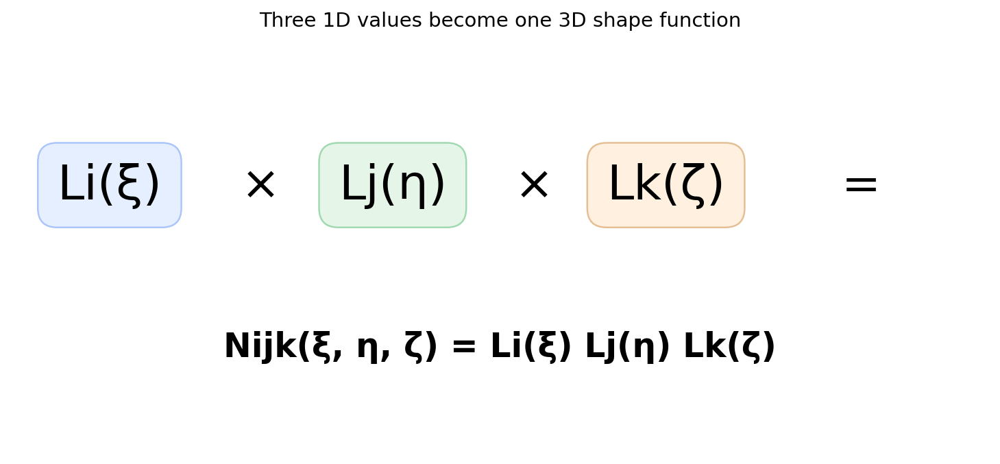

*Figure: Three 1D basis functions multiply to create one 3D nodal basis. Generated by the bundled Python plotting code; see outputs/figure_manifest.json for numerical checks.*


## Follow one parent-space evaluation point

Our recurring sample is **(ξ,η,ζ) = (0.2, −0.4, 0.1)**. At that point the code will print the four 1D values in each direction, then all 64 shape-function values and gradients, then the mapped physical gradients. The final step produces the matrix B and tests it against a known displacement field. There is no material constitutive law, stiffness integration, mesh convergence study, or structural certification in this first tutorial.

## Get the code and reproduce the figures

The ZIP bundle contains a sibling **HermiteStructural-Tutorial001/** VS Code project and a **Jekyll-site-overlay/** directory for your existing blog. See the ZIP's **START-HERE.md** before copying anything. Run `python -m tutorial001.examples` to inspect numbers and `python -m tutorial001.plots` to regenerate graphics.

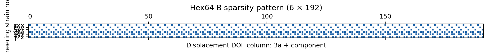

*Figure: Sparsity structure of the final 6×192 Hex64 small-strain B matrix. Generated by the bundled Python plotting code; see outputs/figure_manifest.json for numerical checks.*


## How to participate

Every page includes a discussion box. Posting will become available when GitHub Discussions and Giscus are connected.

---

<a id="lagrange-01"></a>
# Lagrange 01 - Four reference points

Four points on a line seem too modest to deserve an entire lesson, but the coordinates determine the polynomial zeros, derivative values, numbering tables, and ultimately the positions of every nodal degree of freedom. We therefore begin with the one-dimensional reference interval.

## 1. What is a reference coordinate?

The dimensionless parent coordinate ξ lives on **[−1,1]**. The other two parent coordinates, η and ζ, use the same interval. A physical element may be measured in inches or meters and may be distorted, but these parent coordinates provide a standard space where the basis is evaluated. The later Jacobian will relate this parent space to actual x,y,z geometry.

## 2. The polynomial order tells us how many points we need

A polynomial of degree p is uniquely determined by values at p+1 distinct positions. For this tutorial we choose *equally spaced* Lagrange nodes:

$$
\xi_i=-1+\frac{2i}{p},\qquad i=0,1,\ldots,p.
$$

| Element | Polynomial order p | ξ positions | Points on each axis | Nodal positions in 3D |
|:--|--:|:--|--:|--:|
| Hex8 | 1 | −1, +1 | 2 | 2³ = 8 |
| Hex27 | 2 | −1, 0, +1 | 3 | 3³ = 27 |
| Hex64 | 3 | −1, −1/3, +1/3, +1 | 4 | 4³ = 64 |

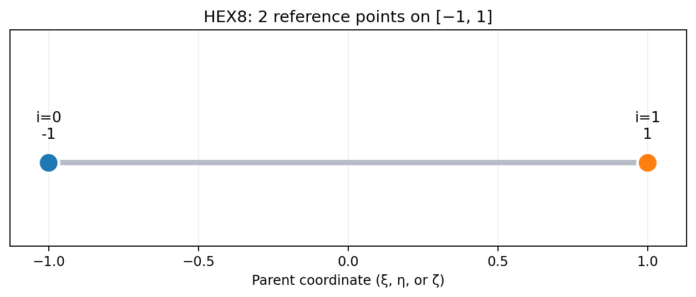

*Figure: Hex8: two equally spaced points. Generated by the bundled Python plotting code; see outputs/figure_manifest.json for numerical checks.*

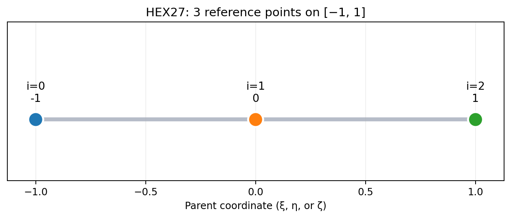

*Figure: Hex27: three equally spaced points. Generated by the bundled Python plotting code; see outputs/figure_manifest.json for numerical checks.*

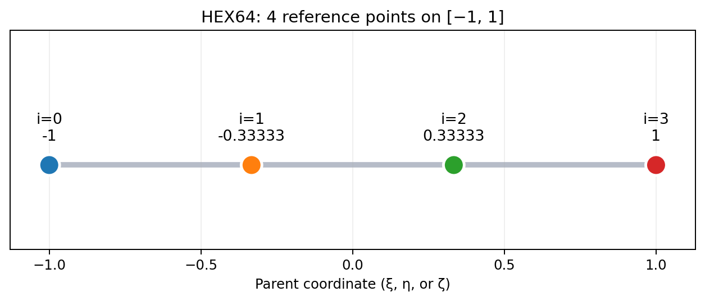

*Figure: Hex64: four equally spaced points. Generated by the bundled Python plotting code; see outputs/figure_manifest.json for numerical checks.*


These are **interpolation nodes**, not Gauss integration points. A later tutorial about stiffness integration will use quadrature rules; the integration abscissae and the nodal interpolation positions must not be conflated.

## 3. Explicit Python construction

```python
import numpy as np

def linear_points(order: int) -> np.ndarray:
    if order not in (1, 2, 3):
        raise ValueError("Supported polynomial orders: 1, 2, 3")
    return np.linspace(-1.0, 1.0, order + 1)

print("Hex8:", linear_points(1))
print("Hex27:", linear_points(2))
print("Hex64:", linear_points(3))
```

```text
Hex8:  [-1.  1.]
Hex27: [-1.  0.  1.]
Hex64: [-1.         -0.33333333  0.33333333  1.        ]
```

## 4. Why the four Hex64 points are not four nodes in the complete solid

The four coordinates are merely the available positions on **one axis**. A three-dimensional tensor product chooses an ξ position, an η position, and a ζ position for every local node. With four choices for each coordinate, there are 4×4×4 = 64 different triples. Nothing has been interpolated yet; at this stage we have only node coordinates and a plan for their order.

## 5. What the point graphic actually verifies

A useful point plot should show every point on the horizontal axis, identify its index, and display equal spacing. The Python verification also checks that `np.diff(points)` is constant and that both endpoints are represented. Point spacing is not a proof that the later basis code is correct; that proof comes next.

## 6. Try the experiment

Change `order` from 1 to 2 to 3 and inspect the plotted markers. Then ask what would happen if you retained four points but made one duplicate: the Π denominators in the next lesson would include zero. Distinct coordinates are essential.

---

<a id="lagrange-02"></a>
# Lagrange 02 - The capital Pi functions

The job of a shape function is to return one at its own node and zero at all competing nodes. The capital Π symbol is simply an efficient mathematical way to express a product of factors that enforce exactly that behavior.

## 1. Define all four basis polynomials

For a set of distinct nodes ξ₀, …, ξₚ, the i-th Lagrange basis is

$$
L_i(\xi)=\prod_{\substack{j=0 \\ j\ne i}}^p \frac{\xi-\xi_j}{\xi_i-\xi_j}.
$$

The denominator normalizes the function so that at ξ=ξᵢ, every factor is one. At any different nodal point ξ=ξⱼ, one numerator vanishes, so the product becomes zero. This is the **Kronecker-delta** property:

$$
L_i(\xi_j)=\delta_{ij}.
$$

## 2. A hand-worked Hex64 polynomial

For **i=0** and ξ₀=−1, the other nodes are −1/3, +1/3, +1. Hence

$$
L_0(\xi)=\frac{(\xi+1/3)(\xi-1/3)(\xi-1)}{(-1+1/3)(-1-1/3)(-1-1)}.
$$

The denominator is **−16/9**. Evaluate at ξ=−1 and the numerator also equals −16/9, producing one. Evaluate at any of the other three nodes, and one numerator factor vanishes. That single example exposes the construction for every basis member.

## 3. Show all curves, not just the formulas

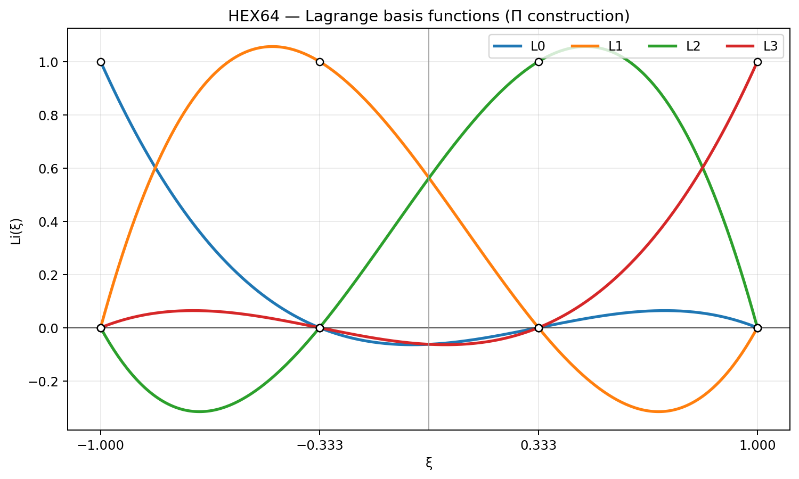

*Figure: All four cubic 1D Hex64 Lagrange basis curves. Generated by the bundled Python plotting code; see outputs/figure_manifest.json for numerical checks.*


Each curve is a cubic because its Π product contains three linear factors. The curves may be negative between nodes; this is normal for high-order Lagrange interpolation. A negative *shape-function value* does not automatically indicate a negative physical displacement. It is a weighting coefficient within an interpolated sum.

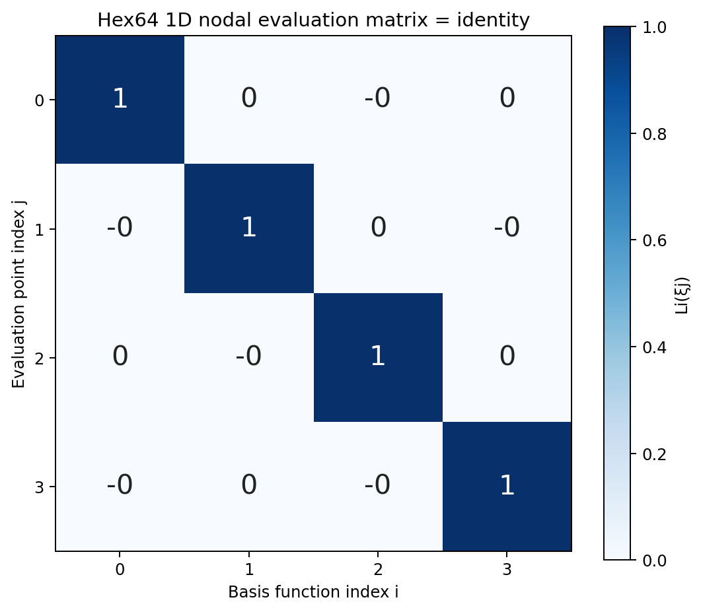

*Figure: Nodal interpolation values form a four-by-four identity. Generated by the bundled Python plotting code; see outputs/figure_manifest.json for numerical checks.*

<aside class="hs-matrix-note" aria-label="Interpolation versus stiffness">
  <p><strong>Why show an identity matrix here?</strong> This is a <strong>nodal evaluation matrix</strong>: each row evaluates all four 1D basis functions at one interpolation node. The identity is the expected result of the Kronecker-delta property—each function is one at its own node and zero at the others. It makes a useful, easy-to-inspect check that the basis was constructed and normalized correctly; it is not an assumed pattern for every matrix in the solver.</p>
  <p><strong>Local and global stiffness matrices have a different role.</strong> The matrix above is not the element stiffness matrix or the assembled global stiffness matrix. For a Hex64 solid with three displacement components per node, the local stiffness matrix has 192 × 192 entries and is computed from spatial shape-function derivatives, material properties, and element geometry by integrating \(\mathbf K^{(e)}=\int_{\Omega_e}\mathbf B^T\mathbf D\mathbf B\,dV\). It generally contains off-diagonal entries that couple displacement degrees of freedom. Assembling element contributions produces the global stiffness matrix, which is typically sparse and is generally not an identity matrix either.</p>
  <p>The identity shown here checks <strong>interpolation values at nodes</strong>; stiffness describes <strong>force–displacement coupling throughout the element and mesh</strong>. The nodal identity property still holds when stiffness is built—it does not imply that the nodes act independently.</p>
</aside>


## 4. Translate the Π symbol into nested loops

```python
def lagrange_basis_values(x_nodes, x):
    values = np.ones(len(x_nodes))
    for i in range(len(x_nodes)):
        for j in range(len(x_nodes)):
            if i != j:
                values[i] *= (x - x_nodes[j]) / (x_nodes[i] - x_nodes[j])
    return values
```

The outer loop chooses *which basis polynomial* is being built. The inner loop multiplies its factors. The `if i != j` is essential: the omitted factor would have zero denominator, because ξᵢ−ξᵢ=0. For a Hex64 element each outer iteration uses exactly three factors.

## 5. Concrete numbers at ξ=0.2

```python
pts = np.array([-1., -1/3, 1/3, 1.])
print(lagrange_basis_values(pts, 0.2))
# [-0.032  0.216  0.864 -0.048]
```

Notice that the four values add to **1.000**. The third nodal basis is dominant because 0.2 is closer to +1/3 than to the other node locations. This is interpolation between nodes, not a lookup at a node.

## 6. Why the plotted nodal matrix is an identity

The figure named `hex64_cardinal_identity.png` computes four full basis vectors, one at each nodal ξ. Stacking these row vectors gives the 4×4 identity. The white markers on each curve also show its zero/one locations.

## 7. How the same code changes across families

Changing only `x_nodes` from two to three to four entries changes the polynomial degree from one to two to three. No new Π derivation is necessary. The element-specific work comes later, when all 1D functions are multiplied across axes and numbered consistently.

---

<a id="lagrange-03"></a>
# Lagrange 03 - Differentiate the Pi products

Interpolation values tell us how nodal displacements are blended. But strain measures spatial variation: we need to differentiate the interpolation. The derivative is not obtained by taking the derivative of each factor separately and multiplying the results together. Instead, the **product rule** differentiates one factor at a time and adds the resulting terms.

## 1. Differentiate the full Π product

Starting with

$$
L_i(\xi)=\prod_{j\ne i}\frac{\xi-\xi_j}{\xi_i-\xi_j},
$$

we obtain

$$
L_i'(\xi)=\sum_{m\ne i}\left(\frac{1}{\xi_i-\xi_m}\prod_{\substack{j\ne i \\ j\ne m}}\frac{\xi-\xi_j}{\xi_i-\xi_j}\right).
$$

For a cubic basis, each of the three added terms contains a product of two linear factors, so the derivative is quadratic.

## 2. Why we use the expanded product rule

There is also a logarithmic-derivative form involving 1/(ξ−ξⱼ). Although valid away from the nodal roots, it requires special treatment at those roots. The direct sum-of-products formula works **at the nodes as written** and is easier to verify in a teaching implementation.

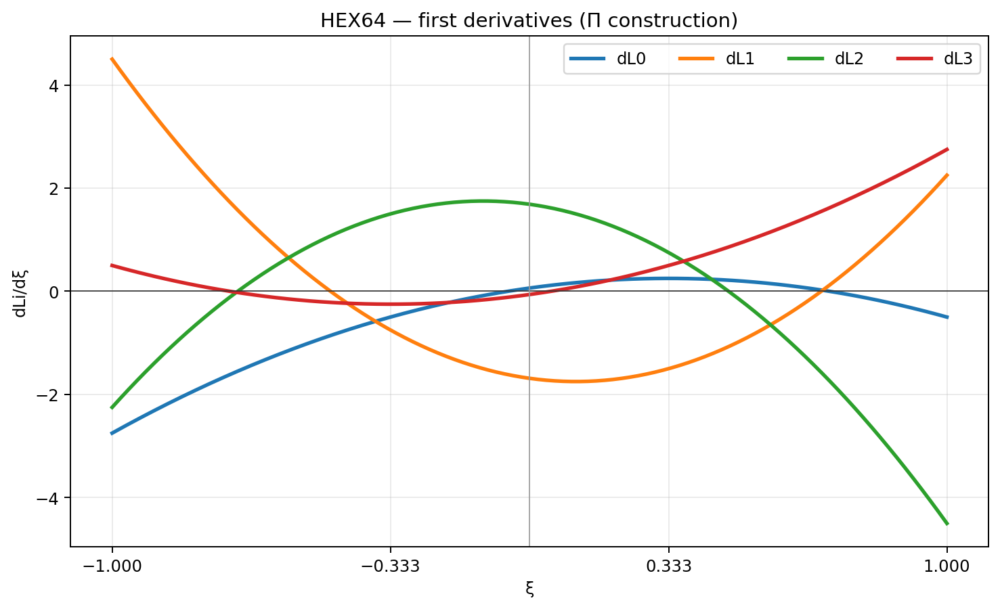

*Figure: Derivatives of the four cubic basis polynomials. Generated by the bundled Python plotting code; see outputs/figure_manifest.json for numerical checks.*


## 3. Literal Python code

```python
def lagrange_basis_derivatives(nodes, x):
    dL = np.zeros(len(nodes))
    for i in range(len(nodes)):
        for m in range(len(nodes)):
            if m == i:
                continue
            term = 1.0 / (nodes[i] - nodes[m])
            for j in range(len(nodes)):
                if j != i and j != m:
                    term *= (x - nodes[j]) / (nodes[i] - nodes[j])
            dL[i] += term
    return dL
```

Observe the **three** indices: `i` selects the shape function, `m` chooses which Π factor is differentiated, and `j` multiplies the remaining factors. With four nodes there are four `i` values, three `m` values per `i`, and two remaining `j` factors per differentiated term.

## 4. Concrete derivative values at ξ=0.2

```text
L(0.2)  = [-0.032, 0.216, 0.864, -0.048]
dL(0.2) = [ 0.22, -1.71,  1.26,  0.23]
```

The sum of the basis values is one; the sum of their derivatives is zero. This second identity is mandatory: differentiating an exact constant function must produce zero.

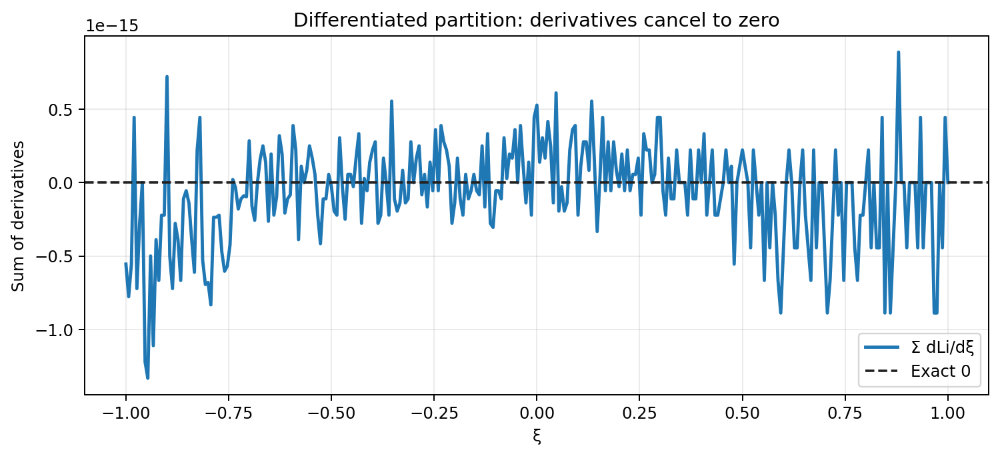

*Figure: The four derivative curves sum to zero at every point. Generated by the bundled Python plotting code; see outputs/figure_manifest.json for numerical checks.*


## 5. Three independent verification methods

**(a) Algebraic:** since Σᵢ Lᵢ(ξ)=1, differentiation gives Σᵢ Lᵢ′(ξ)=0.

**(b) Numerical:** sample 301 positions between −1 and +1 and plot the sum of the derivative arrays. The resulting residual should be at roundoff scale, not a visible curve.

**(c) Independent finite difference:** evaluate each basis at ξ±h and compare `(L(ξ+h)-L(ξ-h))/(2h)` with the analytic product-rule result. The tests do this for all three element families, away from the endpoints and near an endpoint.

## 6. What the derivative is not yet

At this stage `dL/dξ` uses dimensionless **parent space**. It is not the physical derivative `dL/dx` in inches⁻¹ or meters⁻¹. In 3D we first build all dN/dξ, dN/dη, dN/dζ, then transform them through the geometry Jacobian.

---

<a id="lagrange-04"></a>
# Lagrange 04 - The nested for loops

A cube has three independent directions. Once each direction has its 1D interpolation positions, a triple loop creates **every local node** as a coordinate triple. The exact order of those loops is not cosmetic: it controls the local node identifiers, the matching rows of the gradient arrays, and the columns of the final B matrix.

## 1. The nested loop in the companion implementation

```python
n = len(points)
for i in range(n):                 # ξ index: changes slowest
    for j in range(n):             # η index
        for k in range(n):         # ζ index: changes fastest
            a = i*n*n + j*n + k
            xi, eta, zeta = points[i], points[j], points[k]
            # local node "a" is at (xi, eta, zeta)
```

This loop order follows the **i, j, k** tensor-product ordering with **k fastest** used in an earlier `HermiteStructural` nodal Lagrange source example. It is deliberately different from an alternative `for k / for j / for i` numbering you may see elsewhere. Both are mathematically possible, but mixing the conventions inside one element is a serious implementation error.

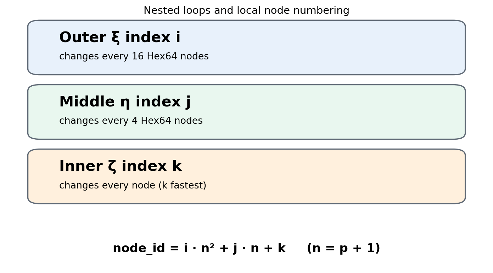

*Figure: The outer, middle, and inner loop roles in Hex64 indexing. Generated by the bundled Python plotting code; see outputs/figure_manifest.json for numerical checks.*


## 2. Hand trace the first few Hex64 nodes

For n=4, the formula becomes `a = 16*i + 4*j + k`.

| a | i | j | k | ξ | η | ζ |
|--:|--:|--:|--:|:--|:--|:--|
| 0 | 0 | 0 | 0 | −1 | −1 | −1 |
| 1 | 0 | 0 | 1 | −1 | −1 | −1/3 |
| 2 | 0 | 0 | 2 | −1 | −1 | +1/3 |
| 3 | 0 | 0 | 3 | −1 | −1 | +1 |
| 4 | 0 | 1 | 0 | −1 | −1/3 | −1 |
| 5 | 0 | 1 | 1 | −1 | −1/3 | −1/3 |
| 15 | 0 | 3 | 3 | −1 | +1 | +1 |
| 16 | 1 | 0 | 0 | −1/3 | −1 | −1 |
| 63 | 3 | 3 | 3 | +1 | +1 | +1 |

Notice that nodes **0,1,2,3** differ only in ζ. After k reaches 3, the inner loop resets and j increments. After a complete 4×4 ξ-plane, i increments.

## 3. Watch it happen in each element family

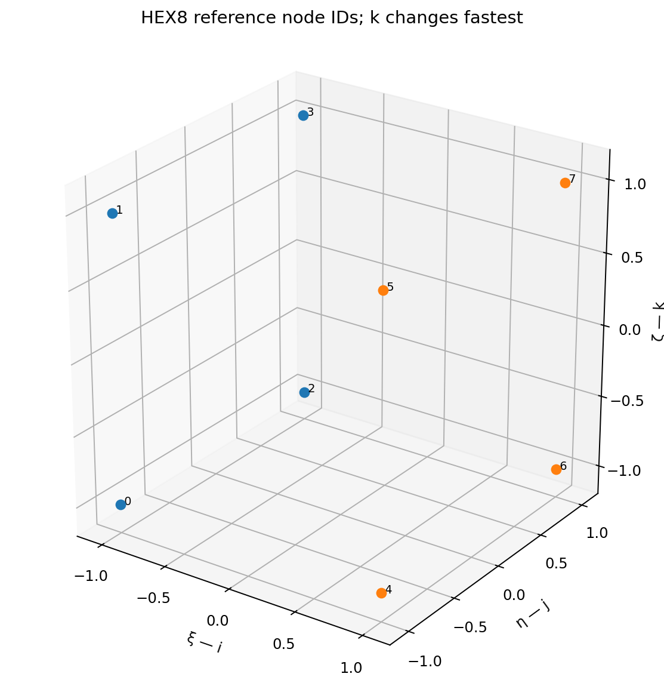

*Figure: Eight numbered positions for the linear element. Generated by the bundled Python plotting code; see outputs/figure_manifest.json for numerical checks.*

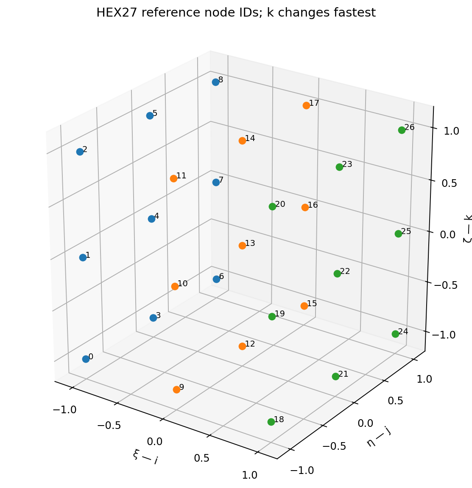

*Figure: Twenty-seven numbered positions for the quadratic element. Generated by the bundled Python plotting code; see outputs/figure_manifest.json for numerical checks.*


*Figure: Sixty-four numbered positions for the cubic element. Generated by the bundled Python plotting code; see outputs/figure_manifest.json for numerical checks.*


The plots display node numbers directly. For Hex64 the labels become crowded by necessity; that crowding is itself instructive and motivates looking at planes or slices when inspecting complicated elements. Download the SVG from the Python `outputs/figures` directory and zoom in for crisp node numbers.

## 4. 3D indexing becomes a one-dimensional array address

At every stage, shape function `N[a]` must be associated with node coordinate `xyz_nodes[a]`, gradient row `dN[a,:]`, and displacement entries `U[3*a:3*a+3]`. The same `a` must mean the same `(i,j,k)` everywhere. The B matrix does not independently guess which node a gradient belongs to.

## 5. Source-order audit to perform

Open your current `Sources` copy and compare its `tensor_shapes` and geometry coordinate loops with this exact ordering. If the production source has a different order, the tutorial should be changed consistently rather than treating the order shown here as universal. The exercises here use a single audited convention end to end.

## 6. An explicit indexing exercise

At i=2, j=1, k=3, compute `a = 2*16 + 1*4 + 3 = 39`. Then reverse the arithmetic: `i = a // 16`, `j = (a % 16)//4`, and `k = a % 4`. Check the record labeled 39 in the node table produced by `enumerate_hex_nodes`.

---

<a id="lagrange-05"></a>
# Lagrange 05 - Tensor-product shape functions

The change from a line to a solid does not require inventing an entirely new family of polynomials. Instead, we multiply three familiar 1D basis values, one from each axis. We evaluate those pieces independently, and the triple loop combines them in exactly the same node order as the previous chapter.

## How do we calculate the L values?

Before multiplying three 1D functions, we must construct each one. For the cubic **Hex64** element, the four equally spaced reference nodes along **each** axis are

$$
s_0=-1,\qquad s_1=-\frac13,\qquad s_2=\frac13,\qquad s_3=1.
$$

Here \(s\) stands for **one** coordinate at a time: \(\xi\), \(\eta\), or \(\zeta\). The Lagrange polynomial associated with node \(i\) is

$$
\boxed{L_i(s)=\prod_{\substack{m=0\\m\ne i}}^3\frac{s-s_m}{s_i-s_m}.}
$$

The product skips \(m=i\). For example, for node 1 (\(s_1=-1/3\)):

$$
L_1(s)=\frac{(s+1)(s-\frac13)(s-1)}{(\frac23)(-\frac23)(-\frac43)}
=\frac{27}{16}(s+1)(s-\frac13)(s-1).
$$

All four functions are:

$$
\begin{aligned}
L_0(s)&=-\frac9{16}(s+\tfrac13)(s-\tfrac13)(s-1),\\
L_1(s)&=\frac{27}{16}(s+1)(s-\tfrac13)(s-1),\\
L_2(s)&=-\frac{27}{16}(s+1)(s+\tfrac13)(s-1),\\
L_3(s)&=\frac9{16}(s+1)(s+\tfrac13)(s-\tfrac13).
\end{aligned}
$$

**Worked example at the center:** setting \(s=0\) gives

$$
[L_0(0),L_1(0),L_2(0),L_3(0)]
=\left[-\frac1{16},\frac9{16},\frac9{16},-\frac1{16}\right].
$$

These four numbers sum to 1. To compute \(L_i(\xi)\), substitute \(s=\xi\); repeat with \(s=\eta\) and \(s=\zeta\). For example, at \((\xi,\eta,\zeta)=(0,0,0)\), node \((i,j,k)=(1,1,1)\) has

$$
N_{111}=L_1(0)L_1(0)L_1(0)=\left(\frac9{16}\right)^3=\frac{729}{4096}\approx0.17798.
$$

The blue, green, and orange factors in the following diagram are simply **three evaluations of this same 1D formula**, each at a different coordinate. For a full derivation, see [Lesson 02 — The capital Π functions](#lagrange-02).

## 1. One node chooses three one-dimensional functions

For the node identified by index triple (i,j,k), define:

$$
N_{ijk}(\xi,\eta,\zeta)=L_i(\xi)L_j(\eta)L_k(\zeta).
$$

For four points on each axis there are 64 such products. These are **shape functions**, not 64 separate cubic Hermite functions. A Hex64 C0 element has three displacement DOFs at each of the 64 nodal positions, giving 192 displacement DOFs.


*Figure: Tensor product of three one-dimensional basis functions. Generated by the bundled Python plotting code; see outputs/figure_manifest.json for numerical checks.*


## 2. Partial derivatives from the product

Since ξ, η, and ζ are independent variables, when differentiating with respect to ξ only the first factor changes:

$$
\frac{\partial N_{ijk}}{\partial\xi}=L_i'(\xi)L_j(\eta)L_k(\zeta),
$$
$$
\frac{\partial N_{ijk}}{\partial\eta}=L_i(\xi)L_j'(\eta)L_k(\zeta),
$$
$$
\frac{\partial N_{ijk}}{\partial\zeta}=L_i(\xi)L_j(\eta)L_k'(\zeta).
$$

At each point the code returns a shape vector `N` of length 64 and a derivative array `dN_ref` with shape `(64,3)`.

## 3. Build the arrays in Python, preserving the node order

```python
n = len(points)
N = np.empty(n**3)
dN_ref = np.empty((n**3, 3))

for i in range(n):
    for j in range(n):
        for k in range(n):
            a = i*n*n + j*n + k
            N[a] = Lxi[i] * Leta[j] * Lzeta[k]
            dN_ref[a, 0] = dLxi[i] * Leta[j] * Lzeta[k]
            dN_ref[a, 1] = Lxi[i] * dLeta[j] * Lzeta[k]
            dN_ref[a, 2] = Lxi[i] * Leta[j] * dLzeta[k]
```

The full function in `tensor_product_hex.py` evaluates `Lxi`, `Leta`, `Lzeta` and their derivatives before entering the loops, avoiding redundant repeated polynomial evaluations.

## 4. Evaluate our sample point

Use **(ξ,η,ζ)=(0.2,−0.4,0.1)**. The three one-dimensional value arrays are:

```text
ξ values: [-0.032,   0.216,    0.864,    -0.048]
η values: [ 0.0385,  1.0395,  -0.0945,    0.0165]
ζ values: [-0.0511875, 0.3898125, 0.7239375, -0.0625625]
```

For node a=0 with (i,j,k)=(0,0,0), the shape value is the product of the **first** value in all three vectors. For node a=39 with (2,1,3), take ξ index 2, η index 1, and ζ index 3. This is how the code turns a local ID into a specific product.

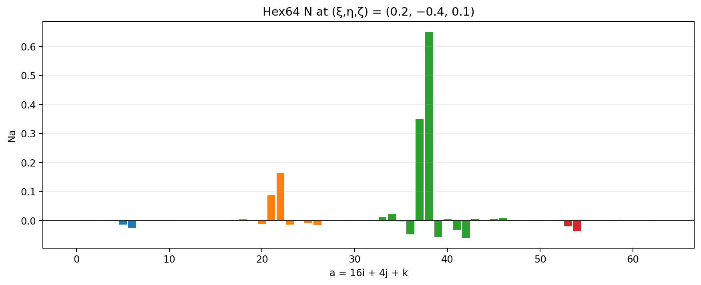

*Figure: Bar chart of all 64 shape values at the worked point. Generated by the bundled Python plotting code; see outputs/figure_manifest.json for numerical checks.*

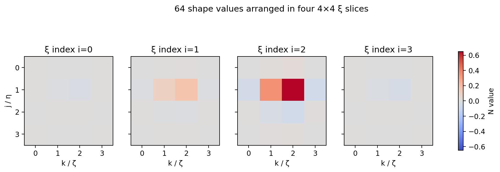

*Figure: Four ξ slices visualize the 64 shape values in array order. Generated by the bundled Python plotting code; see outputs/figure_manifest.json for numerical checks.*


## 5. Show the derivatives, not merely their count

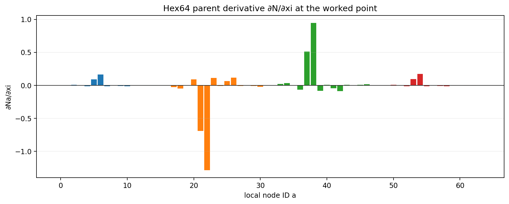

*Figure: All 64 ∂N/∂ξ values. Generated by the bundled Python plotting code; see outputs/figure_manifest.json for numerical checks.*

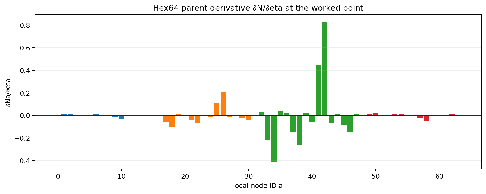

*Figure: All 64 ∂N/∂η values. Generated by the bundled Python plotting code; see outputs/figure_manifest.json for numerical checks.*

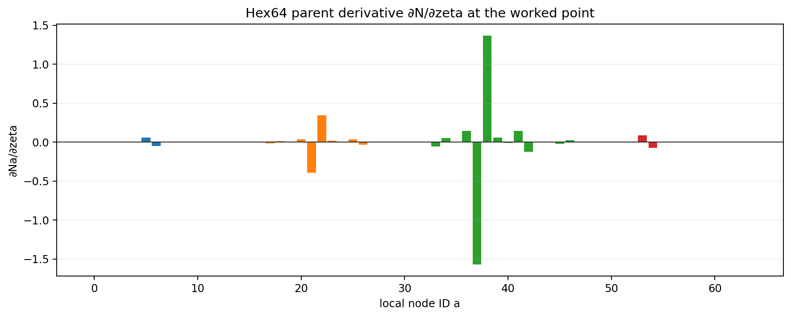

*Figure: All 64 ∂N/∂ζ values. Generated by the bundled Python plotting code; see outputs/figure_manifest.json for numerical checks.*


These bars are signed and some are negative. The important constraints are collective: the shape values sum to one, and each of the three derivative columns sums to zero, within floating-point roundoff. An individual basis value is not required to be positive or less than one.

## 6. Three-dimensional completeness

The tensor-product basis reproduces reference coordinates exactly: ΣₐNₐ ξₐ=ξ, ΣₐNₐ ηₐ=η, and ΣₐNₐ ζₐ=ζ. Differentiating gives the identity matrix for `dN_ref.T @ reference_nodes`. These identities are tested on *every* family and at interior and boundary evaluation points.

## 7. What the heatmap means

The four panels represent the four ξ indices. Within each panel the rows index η and the columns index ζ; these are **indices**, not physical x,y,z dimensions. A plotted high value is an interpolation coefficient at the particular sample point, not a stress concentration. The geometry mapping has not yet happened.

---

<a id="lagrange-06"></a>
# Lagrange 06 - The Jacobian

The 3D derivatives in the previous lesson are expressed in **parent** coordinates. But engineering strains are gradients with respect to the **physical geometry**, so we must know how a step along ξ, η, or ζ moves us in x,y,z. That linearized relationship is the Jacobian.

## 1. The isoparametric geometry mapping

Every physical nodal position is a triple `(x_a,y_a,z_a)`. Inside the element we use the same shape values to interpolate coordinates:

$$
\mathbf{x}(\xi,\eta,\zeta)=\sum_{a=0}^{n-1}N_a(\xi,\eta,\zeta)\mathbf{x}_a.
$$

With `xyz_nodes` shaped `(nnode,3)` and `N` shaped `(nnode,)`, the physical point is `N @ xyz_nodes`. This is **not** a tensor index permutation: it uses the same rows as the node enumeration and tensor shape functions.

## 2. Define the convention before using an inverse

Our Jacobian has **physical coordinate rows** and **parent coordinate columns**:

$$
J=\begin{bmatrix}
\partial x/\partial\xi & \partial x/\partial\eta & \partial x/\partial\zeta\\
\partial y/\partial\xi & \partial y/\partial\eta & \partial y/\partial\zeta\\
\partial z/\partial\xi & \partial z/\partial\eta & \partial z/\partial\zeta
\end{bmatrix}.
$$

In NumPy `J = xyz_nodes.T @ dN_ref`, where `dN_ref` has reference derivatives in **columns**. With row-vector gradients, the chain rule is `grad_ref = grad_physical @ J`, so `grad_physical = grad_ref @ inv(J)`. The implementation uses a linear solve rather than explicitly constructing the inverse.

## 3. Diagram: affine and warped reference solids

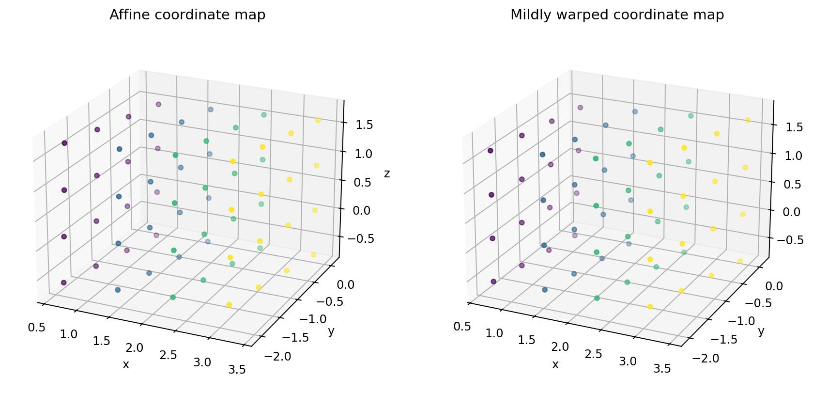

*Figure: Affine and mildly warped physical Hex64 mappings. Generated by the bundled Python plotting code; see outputs/figure_manifest.json for numerical checks.*


An affine geometry is particularly useful for hand calculations because its Jacobian is constant throughout the element. A warped isoparametric element has a Jacobian that can vary with the evaluation point. Both geometries are included in the tests; the small warp is chosen to retain positive determinants.

## 4. The actual Jacobian from the worked point

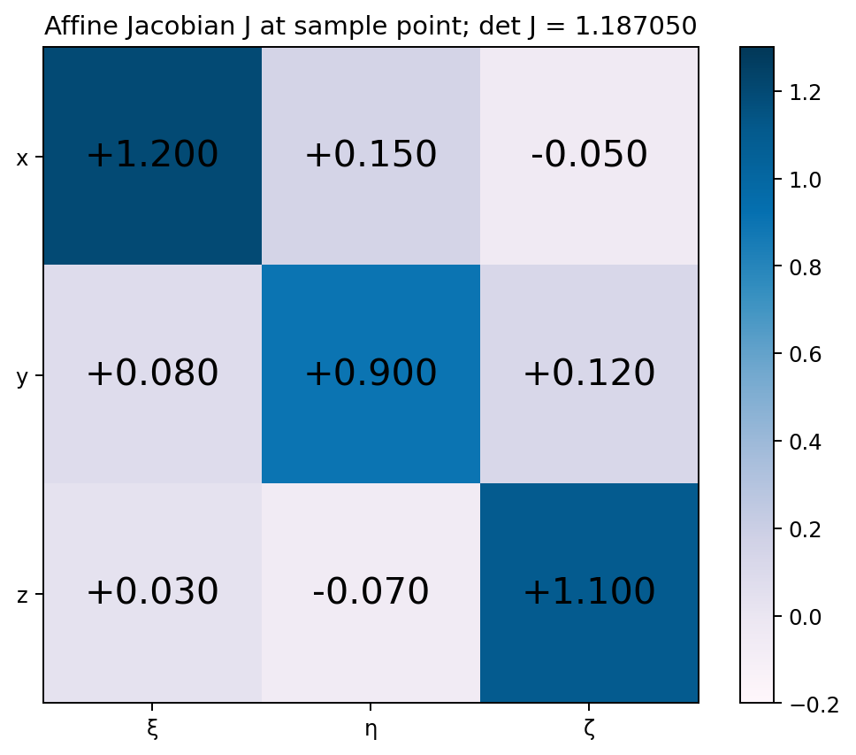

*Figure: Numerical three-by-three Jacobian at the worked point. Generated by the bundled Python plotting code; see outputs/figure_manifest.json for numerical checks.*


```python
J = xyz_nodes.T @ dN_ref  # 3×3

detJ = np.linalg.det(J)
if detJ <= 1e-12:
    raise ValueError("Inverted or singular mapping")

dN_xyz = np.linalg.solve(J.T, dN_ref.T).T
```

For the bundled affine map the Jacobian is

```text
[[ 1.20,  0.15, -0.05],
 [ 0.08,  0.90,  0.12],
 [ 0.03, -0.07,  1.10]]
detJ = 1.18705
```

Notice the off-diagonal terms. If the geometry were axis-aligned, many of these would vanish. Nonzero off-diagonals represent coordinate mixing: physical x can change when η changes, for example.

## 5. Dimensions and signs

If physical coordinates are inches, each entry of the Jacobian has units of inches per dimensionless parent coordinate. Its determinant is proportional to a **local volume scale** in cubic inches, and physical gradients have inverse-inch dimensions. A negative determinant indicates reversed element orientation relative to the chosen ordering. A zero determinant indicates a degenerate local mapping.

## 6. Map the gradients and immediately check them

The mapped array `dN_xyz` has shape `(64,3)`, ordered `[∂N/∂x, ∂N/∂y, ∂N/∂z]` in each row. Two especially useful checks are `sum(dN_xyz, axis=0) == 0` and `dN_xyz.T @ xyz_nodes == identity(3)` for the isoparametric linear-coordinate reproduction. We evaluate both in the automated test suite.

## 7. Avoid a subtle inverse-transpose mistake

Many textbooks define the Jacobian with the parent coordinates in rows, or store gradients as columns. Their chain-rule formula therefore *looks* transposed relative to this lesson. Neither convention is inherently wrong, but the source code must adopt one consistently. Always write down array shapes, matrix indices, and how the rows are multiplied before implementing the transformation.

---

<a id="lagrange-07"></a>
# Lagrange 07 - B matrix

We now have the physical gradients needed to construct a strain field. Small-strain 3D elasticity takes the symmetric part of the displacement gradient. In engineering-strain notation, the shear entries include a factor of two relative to tensor shear, and each nodal displacement has three components: u, v, w.

## 1. Start from the displacement interpolation

$$
\mathbf{u}(\mathbf{x})=\sum_a N_a(\mathbf{x})\begin{bmatrix}u_a\\v_a\\w_a\end{bmatrix}.
$$

The element displacement vector has `3*nnode` entries ordered `[u0,v0,w0,u1,v1,w1,...]`. For Hex64 that is 64×3=**192**. In general a derivative of `u(x)` is a sum of nodal displacement components weighted by **physical** shape-function derivatives.

## 2. Explicit strain ordering

$$
\boldsymbol\epsilon =
[\epsilon_{xx},\epsilon_{yy},\epsilon_{zz},\gamma_{xy},\gamma_{yz},\gamma_{zx}]^T.
$$

Here `γxy=∂u/∂y+∂v/∂x`, `γyz=∂v/∂z+∂w/∂y`, and `γzx=∂w/∂x+∂u/∂z`. This definition sets the row order of the B matrix.

## 3. Derive one 6×3 nodal block

For node a with gradients `Nx=∂Na/∂x`, `Ny=∂Na/∂y`, `Nz=∂Na/∂z`, define:

$$
B_a=\begin{bmatrix}
N_x&0&0\\
0&N_y&0\\
0&0&N_z\\
N_y&N_x&0\\
0&N_z&N_y\\
N_z&0&N_x
\end{bmatrix}.
$$

Then concatenate `B=[B0 B1 ... B63]` horizontally. The result is 6 rows and 192 columns. Multiplying this matrix by the displacement vector yields the engineering strain at the chosen evaluation point.

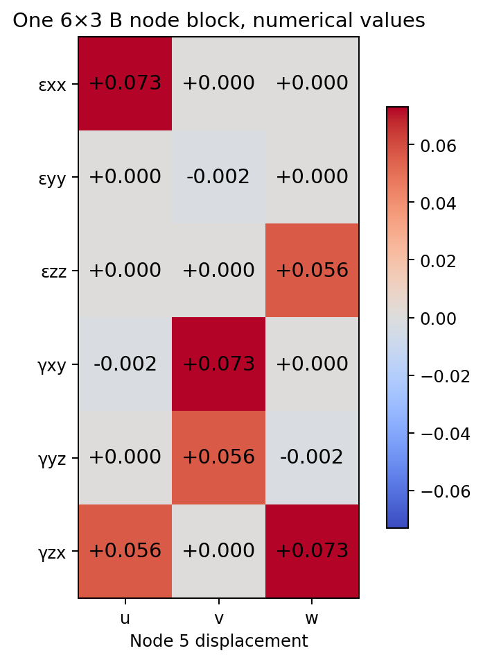

*Figure: Six-by-three block for one specific nodal displacement. Generated by the bundled Python plotting code; see outputs/figure_manifest.json for numerical checks.*


## 4. Read the assembly code row by row

```python
B = np.zeros((6, 3*nnode))
for a, (dx,dy,dz) in enumerate(dN_xyz):
    c = 3*a
    B[0,c] = dx               # εxx from u,x
    B[1,c+1] = dy             # εyy from v,y
    B[2,c+2] = dz             # εzz from w,z
    B[3,c] = dy               # γxy from u,y
    B[3,c+1] = dx             # γxy from v,x
    B[4,c+1] = dz             # γyz from v,z
    B[4,c+2] = dy             # γyz from w,y
    B[5,c] = dz               # γzx from u,z
    B[5,c+2] = dx             # γzx from w,x
```

The code has exactly nine nonzero assignments per node block unless some gradient values happen to be zero at the evaluation point. It does not mix the physical and reference derivatives.


*Figure: Nonzero locations in the complete six-by-192 B matrix. Generated by the bundled Python plotting code; see outputs/figure_manifest.json for numerical checks.*


## 5. Three categories of displacement field

**Rigid translation:** every node receives the same vector `(c1,c2,c3)`. The strain must be zero because a translated object does not change length or angles.

**Rigid infinitesimal rotation:** `u(x)=Ω x` where Ω is skew-symmetric. The symmetric strain must again vanish. The test suite checks this explicitly.

**Affine displacement:** `u(x)=A x+b` for a constant 3×3 matrix A. The exact engineering strain is `[Axx,Ayy,Azz,Axy+Ayx,Ayz+Azy,Azx+Axz]`. The numerically computed B product must agree at every point, for both affine and mildly warped geometry.

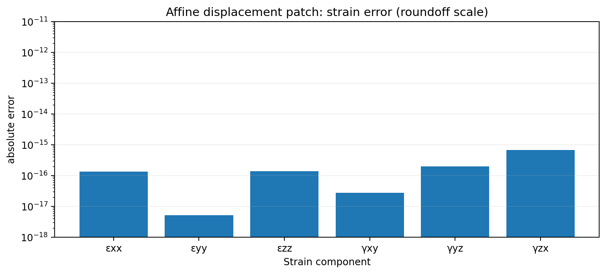

*Figure: Calculated affine strain errors are near floating-point roundoff. Generated by the bundled Python plotting code; see outputs/figure_manifest.json for numerical checks.*


## 6. What this tutorial deliberately does not do

The B matrix is *one ingredient* in the stiffness integral `Ke=∫ Bᵀ C B dV`. Tutorial001 does not form the material matrix C or perform quadrature and assembly into a global sparse system. Nor do the figures represent stresses or maxima. No stress convergence claim can be made from a B-matrix diagram. The next tutorial can address integration once these fundamentals are secure.

---

<a id="lagrange-08"></a>
# Lagrange 08 - Verification

A visually attractive plot can still be wrong. For this reason the final lesson treats graphics as the output of a numerical program whose important identities are also checked independently. We test algebra, indexing, physical coordinate mapping, rigid-body behavior, and constant-strain reproduction.

## 1. Reproducibility rather than trust in screenshots

Run the exact plotting code to regenerate **all 27 named figures**; they are not manually drawn to resemble the expected answer. The `outputs/figure_manifest.json` records the evaluation point, indexing convention, numerical values, determinant, B dimensions, and figure filenames. The tests use the same underlying pure numerical functions but do not infer correctness merely because a plot can be produced.

## 2. Nodal identity (Kronecker delta)

$$
L_i(\xi_j)=\delta_{ij}.
$$


*Figure: Four-by-four interpolation identity matrix. Generated by the bundled Python plotting code; see outputs/figure_manifest.json for numerical checks.*


Test: evaluate each basis vector at each corresponding node and compare the resulting matrix against the identity. For the Hex64 reference data, the maximum nodal cardinal error was **0.0** in the run used to build this package.

## 3. Partition of unity

$$
\sum_i L_i(\xi)=1;\qquad\sum_aN_a(\xi,\eta,\zeta)=1.
$$

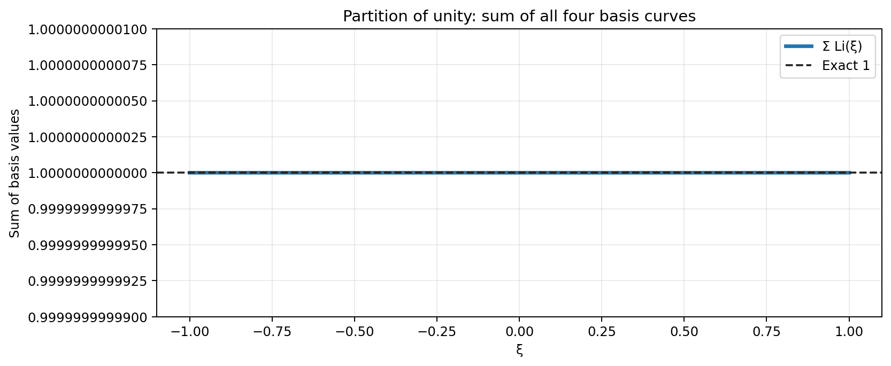

*Figure: Partition of unity evaluated across the entire parent interval. Generated by the bundled Python plotting code; see outputs/figure_manifest.json for numerical checks.*


The sum of the four Hex64 cubic basis functions remains one even when individual functions are negative. Across 301 sampled ξ points, the plotting program measured maximum absolute error **4.44×10⁻¹⁶**.

## 4. Derivative cancellation

$$
\sum_i L_i'(\xi)=0;\qquad\sum_a\partial N_a/\partial\xi=0
$$

and similarly for η and ζ.


*Figure: Sum of derivative polynomials approaches zero at roundoff. Generated by the bundled Python plotting code; see outputs/figure_manifest.json for numerical checks.*


The 301-point derivative-sum sweep measured maximum absolute residual **1.33×10⁻¹⁵**. These values are floating-point residuals, not theoretical errors in the polynomial identities.

## 5. Derivatives independently cross-checked

The Python tests compare the analytic product-rule derivative against a centered finite-difference derivative at three distinct non-nodal evaluation points per family. This is a useful independent construction, though it has its own truncation and floating-point error; it is not the only verification we use.

```python
h = 1e-6
fd = (lagrange_basis_values(nodes, x+h)
      - lagrange_basis_values(nodes, x-h))/(2*h)
assert np.allclose(lagrange_basis_derivatives(nodes,x), fd, atol=1e-9)
```

## 6. Nodal ordering and coordinate reproduction

The tests verify `a=i*n*n+j*n+k`, with k as the innermost loop, for all three element families. They also check `N @ reference_nodes == (ξ,η,ζ)` and `dN_ref.T @ reference_nodes == identity(3)`. Those tests catch mistakes that an unnumbered 3D node plot might conceal.

## 7. Geometry mapping checks

At two non-nodal evaluation points in each element family, both affine and warped geometry are mapped. Every tested Jacobian has positive determinant; the physical gradients satisfy the derivative sum and coordinate-gradient identity. A deliberately inverted element is rejected. The affine Hex64 example used for the figures has `detJ = 1.18705`.


*Figure: Constant strain patch error at the worked point. Generated by the bundled Python plotting code; see outputs/figure_manifest.json for numerical checks.*


## 8. Rigid-body and constant-strain patch tests

Rigid translation and infinitesimal rotation must produce **zero** strain. For the affine displacement field `u=A x+b`, the B matrix should return the exact constant engineering-strain vector. This latter test is repeated for Hex8, Hex27, and Hex64 and for affine and warped geometry; the figure-producing Hex64 run measured maximum strain error **6.78×10⁻¹⁶**.

## 9. Execute the tests yourself

```powershell
cd "$env:USERPROFILE\repos\HermiteStructural-Tutorial001"
.\.venv\Scripts\python.exe -m pytest -v
.\.venv\Scripts\python.exe -m tutorial001.examples
.\.venv\Scripts\python.exe -m tutorial001.plots
```

This release passed **28 pytest checks** when packaged in the authoring environment. Re-run them after extracting on Windows; platform and library-version differences can change last-digit residuals.

## 10. What verified does and does not mean

Verified here means the numerical functions satisfy the listed interpolation and strain identities to the specified tolerances. It does **not** mean the full HermiteStructural solver is certified, that a mesh study has converged, that computed stresses are trustworthy extrema, or that a structure is safe. The tutorial does not sample centroid-only stresses and does not use stress plots as proof of convergence. A later stress-visualization tutorial should explicitly sample element boundaries or inset corners and preserve one-sided values.

## 11. A productive reader challenge

Use the tests to deliberately inject a bug: swap `j` and `k` in only the shape-function loop but *not* the geometry/node generation loop, or use the transpose of the Jacobian in the chain rule. See which test catches it first. Restore the original code and rerun the suite. This exercise makes the connection between indexing, geometry and mechanics concrete.

---

<a id="appendix-a1"></a>
# Appendix A1 - The first-degree eight-node hexahedron

This appendix preserves the first documentation anchor from **HexahedronMomentDocs**: an eight-node isoparametric brick, its natural-coordinate axes, its corner labels, and the displacement and rotation annotations at P1. It connects that diagram to the Lagrange construction developed in Tutorial001.

[Download the preserved source package](assets/downloads/tutorial001/appendix-a1-hexahedron-moment-docs.zip) to keep the original README, requirements, Python reconstruction script, and reference image together. The snapshot was copied on November 4, 2026 from [HexahedronMomentDocs](https://github.com/cognitiveforge630/HexahedronMomentDocs), commit `fc9e40c369692d513eeed7e3775989d96cf7ff21`.

## 1. The original reference and its reconstruction

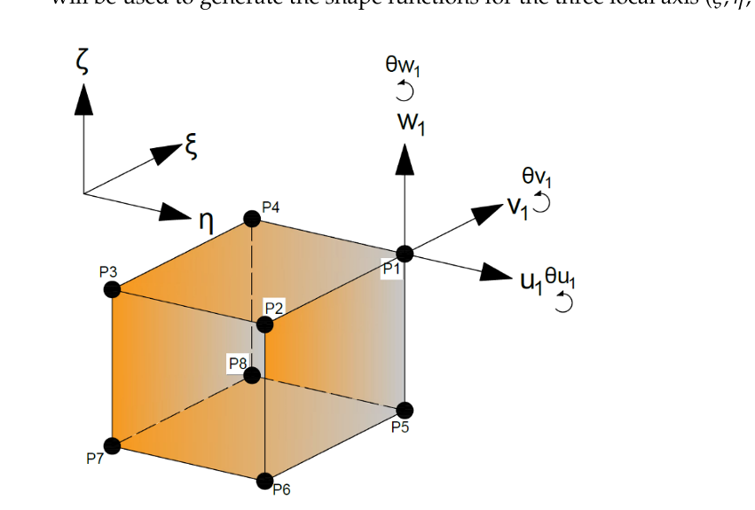

*Original reference image preserved from HexahedronMomentDocs. Its README identifies this as the starting diagram from HexahedronMoment.pdf; the full PDF is not included in this snapshot.*

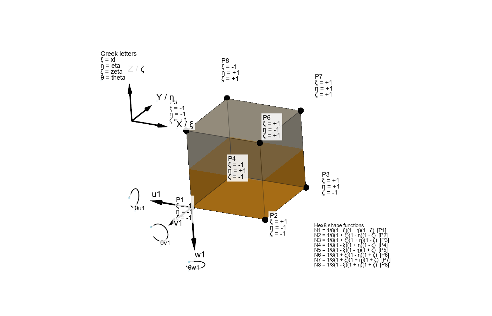

*Reconstruction generated by the preserved Python script. The viewing orientation differs from the reference; the signed coordinates in the table below define the reconstruction's node convention.*

The reconstruction is a conceptual geometry and notation aid. It does not yet derive or implement the full Hexahedron Moment formulation.

<aside class="hs-matrix-note" aria-label="Displacements and rotations in the reference">
  <p><strong>Reading the rotation arrows:</strong> the source diagram and reconstruction show translations u1, v1, w1 and rotations θu1, θv1, θw1 at P1. These annotations preserve the broader formulation's notation. Tutorial001 uses conventional C0 displacement-only Lagrange solids: Hex8 has three displacement degrees of freedom per node, hence 24 in total. The rotation arrows do not add independent rotational degrees of freedom to that element. A formulation with independent nodal rotations requires its own interpolation and governing equations.</p>
</aside>

## 2. What “first degree” means

Hex8 uses two interpolation nodes per axis, at −1 and +1. Its one-dimensional basis functions are

$$
L_-(s)=\frac{1-s}{2},\qquad L_+(s)=\frac{1+s}{2}.
$$

Each is linear in its single coordinate. Multiplying one factor from each axis gives a **trilinear** shape function: degree one in each of ξ, η, and ζ, with mixed products such as ξηζ. “First degree” here refers to the degree along each axis.

For a corner a whose signs are \((\xi_a,\eta_a,\zeta_a)\),

$$
N_a(\xi,\eta,\zeta)=\frac18(1+\xi_a\xi)(1+\eta_a\eta)(1+\zeta_a\zeta).
$$

This is the two-node-per-axis version of [Lesson 05 — Tensor-product shape functions](#lagrange-05). The same product construction gives Hex27 with three nodes per axis and Hex64 with four.

## 3. Keep the node ordering explicit

The preserved script uses the following corner order. The final column maps it to Tutorial001's zero-based, k-fastest Hex8 ordering from [Lesson 04](#lagrange-04).

| Script label | ξ | η | ζ | Tutorial001 index a |
|:--|--:|--:|--:|--:|
| P1 | −1 | −1 | −1 | 0 |
| P2 | +1 | −1 | −1 | 4 |
| P3 | +1 | +1 | −1 | 6 |
| P4 | −1 | +1 | −1 | 2 |
| P5 | −1 | −1 | +1 | 1 |
| P6 | +1 | −1 | +1 | 5 |
| P7 | +1 | +1 | +1 | 7 |
| P8 | −1 | +1 | +1 | 3 |

The reconstruction's P1–P8 sequence is a corner convention, while the tutorial enumerates tensor-product indices. Match coordinates when moving between them; reorder connectivity, shape values, and derivative rows consistently.

## 4. A small worked check

At P1, \((\xi,\eta,\zeta)=(-1,-1,-1)\),

$$
N_1=\frac18(1-\xi)(1-\eta)(1-\zeta)=1.
$$

Every other corner function has at least one zero factor there. Evaluating all eight functions at all eight corners therefore gives the 8 × 8 nodal identity, provided rows and columns use the same ordering.

At the element center, every shape value is 1/8, and all eight sum to one. This provides a quick check on both the signs and the normalization.

The isoparametric position and displacement fields use those same scalar functions:

$$
\mathbf x(\xi,\eta,\zeta)=\sum_{a=1}^{8}N_a\mathbf x_a,
\qquad
\mathbf u(\xi,\eta,\zeta)=\sum_{a=1}^{8}N_a\mathbf u_a.
$$

The Jacobian converts reference derivatives to physical derivatives as explained in [Lesson 06](#lagrange-06), and [Lesson 07](#lagrange-07) uses them to build B. For a displacement-only Hex8 solid, B is 6 × 24. A later local stiffness calculation would produce a 24 × 24 matrix; the nodal identity above describes interpolation, not stiffness.

## 5. Reproduce and keep the work

Extract the source package, open PowerShell in the extracted folder, and run:

```powershell
py -m pip install -r requirements.txt
py tutorial_01_isoparametric_hexahedron.py
```

The second command opens the interactive PyVista view. To save the same diagram without opening an interactive window:

```powershell
py tutorial_01_isoparametric_hexahedron.py --screenshot outputs/isoparametric_hexahedron_ground_zero.png
```

The dependencies are NumPy and PyVista. The script uses Windows Arial when available to render the Greek labels. The source files are preserved unchanged, and the displayed reconstruction was generated from that script for this appendix.

Continue through the eight lessons for the complete displacement-only basis, derivative, Jacobian, and B-matrix construction. This appendix keeps the original diagram work available as a reference while that larger derivation develops.

---
